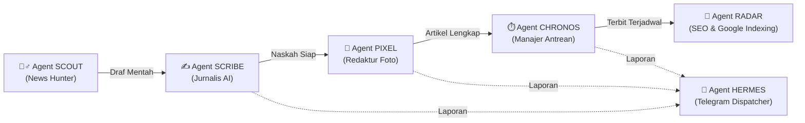

# 🏢 Blueprints: Virtual AI Newsroom Headquarters (Kantor Redaksi Virtual AI)

> **Status Dokumen:** 💡 Konseptual & Perencanaan Arsitektur (Tanpa Implementasi Kode)  
> **Tujuan:** Merancang website antarmuka visual (Dashboard UI) bergaya "Kantor Virtual Agent AI" yang memvisualisasikan seluruh sistem otomasi portal berita Anda secara hidup dan interaktif.

---

## 1. Visi & Filosofi Konsep

Saat ini, website Anda sudah memiliki sistem automasi backend yang luar biasa: AI menyusun naskah, scraper mencari foto Google, kompresor mengecilkan WebP < 100 KB, CDN ImgBB menampung gambar, Waterfall Queue mengatur jam tayang, bot Telegram melapor, dan sitemap mengirim sinyal ke Google.

Namun, di panel admin konvensional, semua proses itu hanya terlihat sebagai teks, tombol, dan tabel angka.

**Konsep "Kantor Redaksi Virtual AI" (AI Newsroom HQ):**  
Mengubah seluruh otomasi di balik layar menjadi sebuah **kantor redaksi digital hidup**. Setiap modul otomasi diberikan **identitas Agent AI**, peran (*job title*), avatar kepribadian, status kerja waktu nyata (*live state*), dan alur meja kerja (*workstation*).

---

## 2. Pemetaan Tim Redaksi AI (Agent Roster) Berdasarkan Sistem Anda

Semua agent ini **bukan fiksi**, melainkan representasi langsung dari script/modul yang sudah aktif di website Anda:

### 1. 🕵️‍♂️ Agent "Scout" — Desk Kurator & Intel Berita
* **Modul Asli:** Endpoint `/api/incoming-news` & Integrasi Bot Telegram.
* **Peran di Kantor:** Memantau feed berita nasional 24/7, menangkap isu viral dan breaking news, lalu meletakkan draf mentah di meja redaksi.
* **Status Kerja:**
  - 🟢 *Monitoring Feed* (Standby memantau sumber Antara, Detik, Kompas, dll).
  - ⚡ *Dispatching News* (Menerima berita baru dan memasukkannya ke antrean draf).

### 2. ✍️ Agent "Scribe" (atau Personas Penulis) — Jurnalis & Redaktur Teks
* **Modul Asli:** `/admin/jurnalis` (`generateJurnalisDraftAction`) & AI Multi-Model (Gemini 3.8 Flash / Claude Thinking / Groq).
* **Peran di Kantor:** Membaca berita mentah, menulis ulang naskah 350–500 kata dengan kaidah jurnalistik, meracik judul editorial yang menarik, menentukan tag SEO, dan menyisipkan rekomendasi internal link "Baca Juga".
* **Status Kerja:**
  - ⚪ *Idle / Menunggu Berita*
  - 🟡 *Writing Draft* (Sedang menyusun naskah via Gemini / Claude)
  - 🟢 *Editing Finished* (Naskah selesai diracik)

### 3. 📸 Agent "Pixel" — Tim Fotografer & Optimasi Visual
* **Modul Asli:** `lib/image-scraper.ts` + `app/admin/image-compressor.ts` + CDN ImgBB.
* **Peran di Kantor:** Menganalisis subjek berita, mencari foto landscape HD bersih tanpa watermark di web, mengompresi ke WebP < 100 KB, dan mengunggahnya ke ImgBB CDN permanen.
* **Status Kerja:**
  - 🔍 *Searching Visuals* (Mencari gambar relevan tokoh / lembaga)
  - 🗜️ *Compressing WebP* (Mengompresi ke target 40–80 KB)
  - ☁️ *Uploading to ImgBB* (Menyimpan foto CDN)

### 4. ⏱️ Agent "Chronos" — Kepala Sirkulasi & Waterfall Scheduler
* **Modul Asli:** `/api/cron/jurnalis-publisher` & Kalibrasi Waktu WIB (`getNextSuggestedPublishTimeAction`).
* **Peran di Kantor:** Menjaga ritme penerbitan agar website selalu segar. Mengatur jeda otomatis (misal 60 menit antar berita) agar artikel tidak terbit bertumpuk.
* **Status Kerja:**
  - ⏳ *Queue Manager* (Menjaga antrean artikel tayang)
  - 🚀 *Publishing* (Menerbitkan artikel saat jadwal jam tayang tiba)

### 5. 📱 Agent "Hermes" — Juru Bicara & Telegram Liaison
* **Modul Asli:** `lib/telegram.ts` (`sendTelegramMessage`).
* **Peran di Kantor:** Menjadi asisten pribadi yang bertugas melapor ke smartphone Pemimpin Redaksi (Anda) via chat Telegram lengkap dengan tombol approval dan link foto.
* **Status Kerja:**
  - 📲 *Notifying Boss* (Mengirim laporan instan ke Telegram Anda)

### 6. 🚀 Agent "Radar" — Spesialis SEO & Google Indexing
* **Modul Asli:** `lib/indexing.ts`, `news-sitemap.xml`, `rss.xml`.
* **Peran di Kantor:** Begitu artikel terbit, agent ini langsung menyebarkan sinyal ping ke Google Indexing API dan Bing IndexNow agar artikel secepat mungkin muncul di halaman 1 pencarian.

### 7. 🛡️ Agent "Sentry" — Tim IT & DevOps (Infrastruktur)
* **Modul Asli:** `/admin/instabox`, `/api/cron/auto-purge`, Neon Postgres Connection Pooler.
* **Peran di Kantor:** Memastikan server VPS tetap hidup, membersihkan sampah log database lama secara otomatis, dan menjaga performa website selalu secepat kilat.

---

## 3. Pilihan Gaya Desain UI Website Kantor AI

Terdapat 3 konsep antarmuka visual yang bisa dipilih:

### Opsi A: "Cyberpunk Command Center" (Paling Modern & Elegan untuk Web)
* **Nuansa:** Dark Mode futuristik ala ruang kendali NASA / Bloomberg Terminal untuk AI.
* **Karakteristik Visual:**
  - Kartu Agent bergaya *Glassmorphism* dengan avatar animasi, badge status berdenyut (pulsi hijau 🟢).
  - **Live Activity Terminal:** Layar hitam di samping yang menampilkan log hidup seperti radar (`[17:20] Agent Pixel: Uploaded WebP cover to ImgBB (64 KB)`).
  - **Pipeline Progress Bar:** Garis aliran dari draf masuk $\rightarrow$ naskah jadi $\rightarrow$ foto terpasang $\rightarrow$ jadwal tayang.
* **Kelebihan:** Sangat cepat dibangun menggunakan Tailwind CSS + Framer Motion di Next.js, terlihat sangat canggih dan profesional untuk portofolio.

### Opsi B: "Pixel-Art Virtual Office 2.5D" (Unik & Gamified)
* **Nuansa:** Tampilan seperti game simulasi (gaya Habbo Hotel / Kairosoft Game Dev Story / Gather.town).
* **Karakteristik Visual:**
  - Denah ruangan kantor mini dengan meja kerja: Meja Penulis, Meja Fotografer, Meja Server, Meja Rapat.
  - Avatar karakter pixel bergerak: saat Agent Scribe menulis, karakter mengetik di laptop; saat Agent Pixel bekerja, karakter memegang kamera.
* **Kelebihan:** Sangat eye-catching, interaktif, dan membuat siapa saja yang melihat merasa kagum dengan tingkat kreativitasnya.

### Opsi C: "Modern SaaS Workspace" (Gaya Linear / Notion AI)
* **Nuansa:** Minimalis, ultra-clean, putih/abu-abu slate dengan tipografi elegan (seperti Linear.app).
* **Karakteristik Visual:**
  - Setiap agent memiliki kartu profil dengan KPI (contoh: *"Agent Scribe: 14 artikel diproduksi hari ini, rata-rata 420 kata"*).
  - Papan Kanban interaktif: Kolom *"Masuk (Scout)"* $\rightarrow$ *"Penyusunan (Scribe)"* $\rightarrow$ *"Pemasangan Foto (Pixel)"* $\rightarrow$ *"Siap Tayang (Chronos)"*.
* **Kelebihan:** Sangat fungsional, rapi, dan nyaman dipakai untuk operasional sehari-hari.

---

## 4. Fitur-Fitur Interaktif yang Bisa Dimiliki Kantor AI

1. **Live Activity Ticker (Papan Aktivitas Hidup):**
   * Menampilkan aliran pekerjaan detik demi detik:
     - `17:15:02` — *Agent Scout: Berita baru masuk dari Antara ("Harga Beras Turun").*
     - `17:15:20` — *Agent Scribe: Menyusun naskah editorial 410 kata via Gemini Flash.*
     - `17:15:24` — *Agent Pixel: Mengambil foto HD Antara, mengompresi ke 58 KB WebP, upload ke ImgBB sukses.*
     - `17:15:25` — *Agent Chronos: Menjadwalkan artikel tayang pukul 18:30 WIB.*
     - `17:15:26` — *Agent Hermes: Mengirim notifikasi ke Telegram Admin.*

2. **Sakelar Kendali Mandor (Admin Override):**
   * Di setiap meja agent, ada sakelar on/off:
     - Anda bisa menonaktifkan Agent Pixel sementara jika ingin memilih foto manual.
     - Anda bisa mengatur kecepatan jeda Agent Chronos (misal 30 menit atau 60 menit).

3. **Tombol "Brief Agent" (Interaksi Langsung):**
   * Anda bisa mengklik profil Agent Scribe dan memberikan instruksi:
     *"Tulis artikel topik AI ini dengan gaya investigasi mendalam"* $\rightarrow$ Agent langsung mengeksekusinya.

4. **Metrik Performa Kantor (Office Stats):**
   * Efisiensi hemat data kompresi foto (contoh: *"Total kuota dihemat: 142 MB"*).
   * Artikel terbit hari ini, estimasi tayang artikel berikutnya, dan status server Neon DB.

---

## 5. Ringkasan & Tindak Lanjut

Ide ini sangat potensial karena **mesin dan logikanya sudah 100% Anda miliki di website ini**. Kita tinggal membuatkan antarmuka visual (halaman UI khusus, misalnya di `/admin/office` atau `/office`) yang membaca status dari database dan menyajikannya dalam bentuk kantor interaktif yang memukau.

Sesuai instruksi Anda, **belum ada kode yang diimplementasikan**.  
Bagaimana pendapat Anda mengenai konsep tim redaksi dan pilihan desain di atas? Konsep gaya mana (Cyberpunk, Pixel-Art, atau Modern SaaS) yang paling menarik minat Anda?
