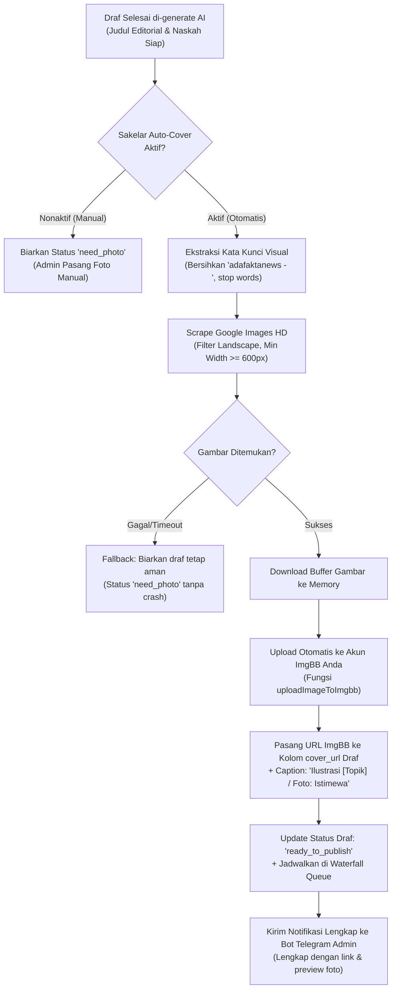

# 📋 Rencana Implementasi: Auto-Cover Image Scraper via Google Images & Sakelar Kendali Admin

> **Status Dokumen:** 📝 Draft Perencanaan (Menunggu Persetujuan Pengguna)  
> **Prinsip Utama:** Tidak ada file kode yang diubah/diimplementasikan sebelum dokumen ini disetujui.

---

## 1. Latar Belakang & Tujuan

* **Masalah:**  
  1. Saat ini setelah draf berita selesai di-generate oleh AI, draf tersebut masih berada pada status *Need Photo* (belum berfoto) sehingga belum bisa diterbitkan otomatis oleh Waterfall Queue.
  2. Gambar dari website sumber asli sering kali mengandung **logo/watermark besar** (seperti logo Detik, Kompas, Tribun, atau Antara) di sudut foto yang kurang profesional jika dipakai ulang.
* **Tujuan Fitur:**  
  1. Mengotomatiskan pencarian gambar ilustrasi/dokumentasi yang **bersih tanpa watermark** langsung dari Google Images berdasarkan judul berita yang dihasilkan AI.
  2. Mengunduh dan mengunggah ulang (*re-host*) gambar tersebut ke akun **ImgBB Anda** agar link gambar permanen dan tidak pernah rusak (*broken link*).
  3. Memasangkan foto ke draf berita dan langsung mengubah statusnya menjadi **`ready_to_publish`** (masuk jadwal antrean tayang runtun).
  4. Menghadirkan **Sakelar On/Off di Web Admin** agar admin dapat memilih antara mode *100% Full Autopilot* atau *Semi-Otomatis (Pilih Foto Sendiri)*.

---

## 2. Diagram Alur Sistem (Workflow)



---

## 3. Rincian Komponen & Logika Teknis

### A. Modul Scraper Gambar Backend (`lib/image-scraper.ts` — File Baru)
Modul ini bertugas mencari gambar di Google Images secara ringan tanpa memerlukan browser virtual:
1. **Pembersihan Kata Kunci (*Smart Query Sanitizer*):**
   * Menghapus prefix pengantar seperti `"adafaktanews - "`.
   * Menghapus tanda petik, kurung, dan kata penghubung (di, ke, dari, pada, untuk, yang, ini, itu).
   * Menghasilkan query visual presisi, contoh: `"Jalan Tol Trans Sumatera pembangunan proyek"`.
2. **Pencarian Google Images:**
   * Melakukan request HTTP dengan headers seluler/desktop modern ke Google Images.
   * Mengekstrak URL gambar beresolusi tajam berformat `.jpg`, `.jpeg`, `.png`, atau `.webp`.
   * Memastikan orientasi gambar adalah **Landscape (Horizontal)** dengan dimensi minimal $\ge 600$ piksel.
3. **Re-host ke ImgBB:**
   * Gambar di-fetch ke memory server (Buffer).
   * Dikirim ke ImgBB via fungsi `uploadImageToImgbb(formData)`.
   * Mengembalikan URL CDN permanen: `https://i.ibb.co.com/xxx/image.jpg`.
4. **Safety Timeout:**
   * Setiap proses pencarian gambar dibatasi timeout maksimal 8 detik. Jika gagal atau koneksi lambat, proses tidak akan memblokir draf (draf tetap tersimpan aman).

---

### B. Penyimpanan Konfigurasi Sakelar (`system_settings`)
* Key database: `jurnalis_auto_cover_enabled` (`'true'` atau `'false'`, Default: `'true'`).
* Server Action di `app/admin/jurnalis/actions.ts`:
  * `getJurnalisAutoCoverConfigAction()`
  * `toggleJurnalisAutoCoverAction(enabled: boolean)`

---

### C. Integrasi ke Worker Cron (`processAutoGenerateNextDraftAction`)
Begitu `generateJurnalisDraftAction(draftId)` sukses:
1. Sistem mengecek status sakelar `jurnalis_auto_cover_enabled`.
2. Jika aktif:
   * Memanggil `searchAndUploadCoverImage(generatedTitle, category)`.
   * Jika URL ImgBB berhasil didapat, memanggil `attachPhotoUrlToDraftAction(draftId, imgbbUrl, caption)`.
   * Draf otomatis berstatus **`ready_to_publish`** dan langsung mendapatkan slot jam tayang terjadwal (*Waterfall Queue*).
3. Jika nonaktif:
   * Draf tetap berstatus `need_photo` dan menunggu admin memasang foto secara manual.

---

### D. Tampilan UI Sakelar di Web Admin (`app/admin/jurnalis/JurnalisClientView.tsx`)
Di kartu kontrol bagian atas, akan dihadirkan dua sakelar yang serasi:

```text
┌────────────────────────────────────────────────────────────────────────┐
│ 🤖 Auto-Generate Naskah AI:     [ 🟢 Aktif  ]                         │
│ 🖼️ Auto-Pasang Foto Sampul:     [ 🟢 Aktif  / ⚪ Nonaktif ]            │
│ ────────────────────────────────────────────────────────────────────── │
│ 💡 Cron otomatis mencari foto bersih di Google, re-upload ke ImgBB,   │
│    dan langsung menjadwalkan artikel ke antrean tayang.                │
└────────────────────────────────────────────────────────────────────────┘
```

* **Bonus Tombol Manual:** Pada tabel draf yang belum memiliki foto, disediakan tombol cepat:  
  `[ 🔍 Auto-Cari Foto Google ]`  
  Sehingga admin bisa memicu pencarian foto Google untuk draf mana pun dengan 1 klik saja.

---

### E. Format Laporan Bot Telegram
Pesan laporan bot Telegram kini akan mengabarkan bahwa foto sampul juga telah terpasang:

```text
🤖 BERITA BARU + FOTO SAMPUL SELESAI DISUSUN!
━━━━━━━━━━━━━━━━━━━━━━━━━━━━
📰 [Judul Berita Baru Hasil AI]

🏷️ Kategori: Infrastruktur | Status: Siap Tayang
🖼️ Foto Sampul: Terpasang (Google Images ➔ ImgBB)
⏰ Jadwal Tayang: Hari ini, 15:30 WIB (Waterfall Queue)

💡 Artikel resmi masuk antrean tayang otomatis dan tidak memerlukan tindakan manual lagi.

[ 📝 Buka di Dasbor Jurnalis ]   [ 🖼️ Lihat Foto Sampul ]
```

---

## 4. Rincian File yang Akan Dibuat dan Diubah

| No | File | Jenis Perubahan | Deskripsi |
|---|---|---|---|
| 1 | `lib/image-scraper.ts` | **File Baru** | Scraper Google Images, filter landscape HD, dan re-host ke ImgBB |
| 2 | `app/admin/jurnalis/actions.ts` | **Modifikasi** | Menambahkan `toggleJurnalisAutoCoverAction`, `autoFetchCoverForDraftAction`, dan integrasi ke cron worker |
| 3 | `app/admin/jurnalis/page.tsx` | **Modifikasi** | Mengoper status awal sakelar auto-cover ke client view |
| 4 | `app/admin/jurnalis/JurnalisClientView.tsx` | **Modifikasi** | Menambahkan switch toggle Auto-Cover & tombol 1-klik di tabel draf |

---

## 5. Persetujuan & Langkah Lanjut

Dokumen rencana ini telah disusun secara mendalam. Tidak ada kode produksi yang diubah sebelum ada persetujuan dari Anda.  
Apakah rancangan di atas sudah sesuai dengan yang Anda harapkan dan siap kita implementasikan?

