# 📋 Rencana Implementasi: Kompresi Foto (< 100 KB) & Perbaikan Auto-Cover Image Scraper

> **Status Dokumen:** 📝 Menunggu Persetujuan Pengguna  
> **Prinsip Utama:** Tidak ada file kode yang diubah/diimplementasikan sebelum rencana ini disetujui.

---

## 1. Latar Belakang & Akar Masalah

Berdasarkan hasil investigasi mendalam terhadap codebase, ditemukan 3 hal utama yang perlu disempurnakan:

### 1.1. Fitur Tambah Foto Manual Jurnalis AI (`DraftPhotoModal.tsx`) Belum Ada Kompresi
* **Kondisi Saat Ini:** Ketika admin memilih foto (misalnya 2 MB – 5 MB dari kamera atau galeri), file mentah tersebut langsung diunggah utuh ke ImgBB tanpa kompresi.
* **Dampak:** Kuota ImgBB cepat habis dan kecepatan load website menjadi berat bagi pembaca.
* **Solusi:** Mengintegrasikan utilitas [`compressImageUnder100KB`](file:///e:/porto/naratif/app/admin/image-compressor.ts) ke dalam modal. Gambar akan otomatis diubah ke format modern **WebP**, resolusi dioptimalkan proporsional, dan ukuran dipastikan **di bawah 100 KB** (target 40 KB – 85 KB) sebelum dikirim ke ImgBB.

### 1.2. Tombol Auto-Generate Foto Gagal / Error ImgBB
* **Akar Masalah:** Saat scraper mengirimkan parameter `imageUrl` langsung ke endpoint API ImgBB (`https://api.imgbb.com/1/upload`), server ImgBB (yang berjalan di PHP 8.4) mengalami error internal:
  `HTTP 400: Constant CURLOPT_BINARYTRANSFER is deprecated since 8.4, as it had no effect since 5.1.2`.
* **Solusi:** Backend Next.js akan mengunduh (*fetch*) buffer gambar kandidat ke memori server terlebih dahulu, lalu mengonversinya menjadi **Base64**. Format Base64 diterima 100% lancar oleh ImgBB tanpa memicu bug cURL PHP 8.4 di server ImgBB.

### 1.3. Gambar Pencarian Melantur / Tidak Sesuai Topik Berita
* **Akar Masalah:**
  1. Pada modal pencarian arsip lama admin, sistem mencari ke Wikimedia Commons yang merupakan arsip ensiklopedia sejarah, bukan database berita harian aktual.
  2. Pembersihan kata kunci (*keyword sanitizer*) sebelumnya terlalu memangkas kata penting, sehingga kata kunci peristiwa spesifik hilang dan menghasilkan gambar acak.
* **Solusi:**
  1. Menyempurnakan pembersih judul: mempertahankan nama tokoh (Presiden, Menteri, Tokoh Publik), lokasi peristiwa, dan kata aksi utama.
  2. Menambahkan filter pencarian gambar berita: orientasi **Landscape (Horizontal)**, resolusi tajam (HD / Large), dan filter anti-placeholder/logo.
  3. Menyediakan mekanisme *multi-candidate fallback* (mencoba kandidat 1, 2, dan 3) jika terdapat gambar yang memiliki proteksi hotlinking.

---

## 2. Diagram Alur Kerja Sistem (Workflow)

```mermaid
flowchart TD
    subgraph ManualUpload["1. Jalur Upload Foto Manual (DraftPhotoModal)"]
        A1["Admin Pilih Berkas Foto\n(Ukuran 1 MB - 5 MB)"] --> A2["Client-Side Auto-Compress\n(app/admin/image-compressor.ts)"]
        A2 --> A3["Hasil: Format WebP < 100 KB\n(Rata-rata 40 KB - 85 KB)"]
        A3 --> A4["Tampilkan Indikator Hemat Ukuran\n'1.8 MB ➔ 62 KB (< 100 KB)'"]
        A4 --> A5["Upload ke ImgBB CDN & Pasang ke Draf"]
    end

    subgraph AutoCover["2. Jalur Auto-Cover (Tombol 1-Klik & Cron Worker)"]
        B1["Judul Berita Hasil AI"] --> B2["Ekstraksi Kata Kunci Spesifik Berita\n(Tokoh, Lembaga, Lokasi, Peristiwa)"]
        B2 --> B3["Pencarian Kandidat Gambar HD & Landscape"]
        B3 --> B4["Server Download Buffer Gambar"]
        B4 --> B5["Konversi Buffer ke Base64\n(Bypass Bug PHP 8.4 ImgBB)"]
        B5 --> B6["Upload Base64 ke ImgBB CDN"]
        B6 --> B7["Pasang Cover URL & Masuk Antrean Waterfall Queue"]
    end
```

---

## 3. Rincian Rencana Perubahan Berkas (Step-by-Step)

### A. Modifikasi [`app/admin/jurnalis/DraftPhotoModal.tsx`](file:///e:/porto/naratif/app/admin/jurnalis/DraftPhotoModal.tsx)
1. Import `compressImageUnder100KB` dari `@/app/admin/image-compressor`.
2. Tambahkan state pelacak proses kompresi:
   - `isCompressing: boolean`
   - `compressionInfo: { originalKB: number; compressedKB: number; savings: number } | null`
3. Pada event `handleFileChange`:
   - Saat admin memilih gambar, langsung jalankan `compressImageUnder100KB(selected)`.
   - Simpan berkas hasil kompresi ke state `file`.
   - Buat URL preview dari berkas hasil kompresi.
   - Tampilkan badge hijau informatif: *"✅ Berhasil dikompresi: 1.8 MB ➔ 64 KB (Hemat 96% | WebP < 100 KB)"*.
4. Pada `handleSubmit`:
   - Mengirim berkas WebP yang sudah pasti berukuran < 100 KB ke server action.

---

### B. Modifikasi [`lib/image-scraper.ts`](file:///e:/porto/naratif/lib/image-scraper.ts)
1. **Penajaman Query (`sanitizeImageSearchQuery`):**
   - Menghilangkan frasa pembuka portal (seperti *"adafaktanews - "*).
   - Mempertahankan kata-kata kunci berita penting (nama lembaga KPK, POLRI, DPR, nama tokoh politik, daerah, serta objek peristiwa).
2. **Filter Pencarian Gambar Tajam & Landscape:**
   - Memastikan hasil pencarian berorientasi horisontal (landscape) dengan rasio lebar yang ideal untuk berita.
3. **Download Buffer & Konversi Base64:**
   - Di dalam `searchAndUploadCoverImage`:
     - Ambil kandidat URL gambar.
     - Lakukan `fetch(candidateUrl)` di server dengan timeout 5 detik.
     - Konversi respon menjadi `Buffer.from(await res.arrayBuffer()).toString('base64')`.
     - Kirim Base64 ke ImgBB API:
       `imgbbBody.append('image', base64Data)`.
   - Mengatasi 100% kegagalan error cURL PHP 8.4 `CURLOPT_BINARYTRANSFER`.
4. **Mekanisme Fallback 3 Kandidat:**
   - Jika kandidat gambar #1 gagal di-download (misal server asal memblokir bot / hotlink protection), otomatis mencoba kandidat #2 dan #3 secara berurutan.

---

### C. Modifikasi [`app/admin/media-actions.ts`](file:///e:/porto/naratif/app/admin/media-actions.ts)
1. Pada fungsi `uploadImageToImgbb`:
   - Jika menerima `imageUrl` (tautan web gambar): alih-alih mengirim URL mentah ke ImgBB, sistem server Next.js akan men-download gambar menjadi buffer dan mengirimkannya sebagai Base64 ke ImgBB.
   - Hal ini membuat semua fungsi upload gambar berbasis URL di seluruh aplikasi menjadi kebal dari bug server ImgBB.

---

### D. Pengujian & Verifikasi (Testing Plan)
1. **Uji Kompresi Modal:**
   - Buka modal "Pasang Foto" di menu Jurnalis AI.
   - Upload file foto berukuran besar (misal 2 MB – 4 MB).
   - Verifikasi apakah badge hijau muncul dan ukuran berkas terbukti menjadi < 100 KB WebP.
   - Simpan, dan pastikan link gambar ImgBB tersimpan dengan baik.
2. **Uji Tombol 1-Klik "Auto-Cari Google":**
   - Klik tombol "Auto-Cari Google" pada draf berita yang belum ada fotonya.
   - Verifikasi bahwa gambar berhasil di-upload ke ImgBB tanpa error cURL PHP 8.4.
   - Pastikan gambar yang didapat relevan dengan topik berita dan berorientasi landscape.
   - Pastikan status draf otomatis berubah menjadi `ready_to_publish` dan masuk antrean tayang.
3. **Uji Build TypeScript:**
   - Jalankan `npx tsc --noEmit` untuk memastikan tidak ada kesalahan tipe data.

---

## 4. Persetujuan Pengguna

Rencana ini telah dirancang untuk menyelesaikan kedua kebutuhan Anda:
1. Menjamin foto upload manual selalu **dikompresi otomatis ke < 100 KB WebP**.
2. Memperbaiki fitur **Auto-Cover Gambar** agar berjalan mulus, tidak error, dan gambarnya relevan dengan berita.

Silakan tinjau rencana di atas. Jika Anda setuju, berikan konfirmasi agar implementasi dapat langsung dimulai.
