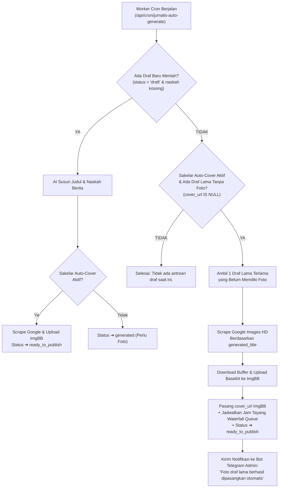

# 📋 Rencana Implementasi: Autopilot Sapu Bersih Foto Draf Eksisting via Cron

> **Status Dokumen:** 📝 Draft Perencanaan Fitur Tambahan (Menunggu Persetujuan Pengguna)  
> **Prinsip Utama:** Tidak ada file kode yang diubah/diimplementasikan sebelum rencana ini disetujui.

---

## 1. Status Fitur Sebelumnya (Telah Selesai & Ter-deploy)

| Fitur | Status | Bukti / Commit |
|---|---|---|
| **Kompresi Otomatis di Modal (< 100 KB WebP)** | ✅ Selesai & Aktif | Commit `81dcb77` (`DraftPhotoModal.tsx`) |
| **Fix Bug ImgBB PHP 8.4 via Base64 Buffer** | ✅ Selesai & Aktif | Commit `81dcb77` (`media-actions.ts`) |
| **Filter Gambar HD & Landscape Berita** | ✅ Selesai & Aktif | Commit `81dcb77` (`image-scraper.ts`) |
| **Tombol 1-Klik "Auto-Cari Google" di Tabel** | ✅ Selesai & Aktif | Siap digunakan di `/admin/jurnalis` |

---

## 2. Kebutuhan Fitur Tambahan yang Direncanakan

### Masalah:
Saat ini di dasbor Redaksi/Jurnalis AI terdapat sejumlah draf berita yang **naskahnya sudah selesai disusun oleh AI**, namun **fotonya masih belum ada** (berstatus *Perlu Foto*).  
Meskipun sudah ada tombol manual 1-klik `[ Auto-Cari Google ]`, mengklik satu per satu untuk banyak draf tetap menyita waktu admin.

### Solusi yang Diusulkan:
Menjadikan worker cron `/api/cron/jurnalis-auto-generate` bekerja secara **Bertingkat (Multi-Stage Autopilot)**:
1. **Prioritas Utama (Berita Baru):** Jika ada draf baru mentah (`status = 'draft'`), AI menyusun naskah + langsung mencarikan foto sampul.
2. **Prioritas Kedua (Sapu Bersih Draf Lama):** Jika tidak ada berita baru yang perlu di-generate, cron tidak menganggur, melainkan memeriksa draf lama yang sudah ber-naskah tapi belum punya foto sampul (`cover_url IS NULL`).
3. Bot akan mengambil 1 draf tersebut secara otomatis, mencari foto Google landscape HD yang relevan, mengunggah ke ImgBB, memasang URL sampul, dan mengubah statusnya menjadi **`ready_to_publish`** (langsung terjadwal di Waterfall Queue).

---

## 3. Diagram Alur Kerja Cron Baru (Priority Waterfall)

---

## 4. Rincian Teknis & Keamanan

1. **Aman dari Timeout Server (Max Execution Time):**
   - Cron hanya memproses **1 draf per putaran**.
   - Setiap putaran hanya memakan waktu 2–4 detik (jauh di bawah batas timeout Vercel 60 detik).
2. **Bebas Limit ImgBB & Mesin Pencari:**
   - Karena berjalan bertahap per putaran cron, tidak ada lonjakan request (*rate-limit safe*).
3. **Waterfall Queue Otomatis:**
   - Setiap draf yang fotonya berhasil dipasangkan akan langsung mendapatkan jam tayang berurutan secara rapi (misal: jeda 1 jam antar berita), sehingga tidak ada artikel yang terbit bertabrakan.
4. **Kendali Penuh di Tangan Anda (Sakelar):**
   - Jika sakelar **Auto-Pasang Foto Sampul** di dasbor web Anda matikan (Off), cron sama sekali tidak akan menyentuh foto draf tersebut.

---

## 5. Berkas yang Akan Diubah

| No | File | Deskripsi Perubahan |
|---|---|---|
| 1 | [`app/admin/jurnalis/actions.ts`](file:///e:/porto/naratif/app/admin/jurnalis/actions.ts) | Menambahkan logika fallback di `processAutoGenerateNextDraftAction()` untuk mencari dan memasang foto pada draf yang belum berfoto jika tidak ada draf baru mentah. |

---

## 6. Persetujuan & Langkah Lanjut

Dokumen rencana fitur tambahan ini telah disusun secara mendalam.  
Tidak ada kode yang diubah sebelum ada persetujuan dari Anda.

Apakah rancangan autopilot sapu bersih foto draf lama di atas sudah sesuai dan siap kita terapkan?
