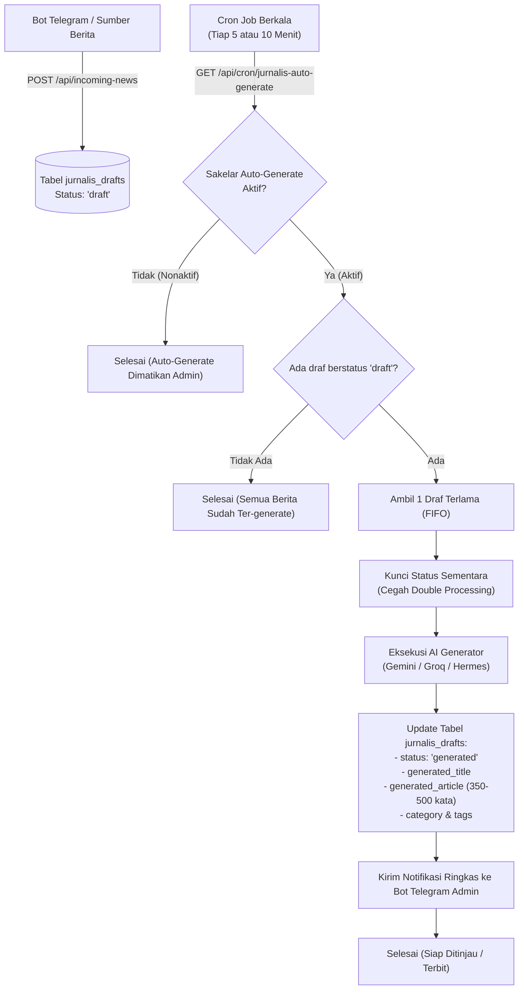

# 📋 Rencana Implementasi: Auto-Generate Berita Jurnalis AI via Cron & Notifikasi Telegram

> **Status Dokumen:** 📝 Draft Perencanaan (Menunggu Persetujuan Pengguna)  
> **Prinsip Utama:** Tidak ada file kode yang diubah/diimplementasikan sebelum dokumen ini disetujui.

---

## 1. Latar Belakang & Masalah

* **Alur Saat Ini (Setengah Manual):**  
  Bot Telegram / scraper mengirim data berita ke endpoint `/api/incoming-news`. Berita disimpan ke database tabel `jurnalis_drafts` dengan status `'draft'`. Namun, naskah berita lengkap (350–500 kata), judul editorial, kategori, dan tags **baru dibuat jika admin membuka web `/admin/jurnalis` lalu mengklik tombol *Generate AI* satu per satu secara manual**.
* **Tujuan Fitur Baru:**  
  Menjadikan alur tersebut **100% Otomatis**:
  1. Cron Job berkala otomatis mengambil draf berita masuk yang belum di-generate.
  2. AI langsung menyusun naskah berita, kategori, dan tags tanpa perlu campur tangan admin.
  3. Setelah selesai, **Bot Telegram otomatis mengirim notifikasi ringkas** ke HP admin.
  4. Tersedia **Sakelar On/Off (Toggle)** di halaman Web Admin (`/admin/jurnalis`) agar admin memegang kendali penuh kapan pun ingin mematikan atau menyalakan fitur ini.

---

## 2. Diagram Alur Sistem (Workflow)



---

## 3. Rincian 4 Komponen Utama

### A. Penyimpanan Konfigurasi Sakelar (Database `system_settings`)
Konfigurasi disimpan di tabel database `system_settings` sehingga instan dan persisten:
* `jurnalis_auto_generate_enabled`: `'true'` atau `'false'` (Default: `'true'`).
* `jurnalis_auto_generate_batch_size`: `'1'` (memproses 1 berita per siklus cron untuk menjaga kestabilan kuota AI dan mencegah rate limit).

---

### B. Endpoint Cron Job Worker (`/api/cron/jurnalis-auto-generate/route.ts`)
1. **Keamanan Endpoint:**
   * Wajib menyertakan otorisasi: `Bearer <CRON_SECRET>` di header atau query parameter `?secret=<CRON_SECRET>`.
2. **Logika Eksekusi:**
   * Cek apakah sakelar `jurnalis_auto_generate_enabled` bernilai `'true'`. Jika `'false'`, hentikan proses dan laporkan `skipped_disabled`.
   * Cari 1 draf dengan kriteria:  
     `status = 'draft' AND generated_article IS NULL` diurutkan dari `created_at ASC` (draf paling awal masuk diproses duluan).
   * Panggil fungsi `generateJurnalisDraftAction(draftId)` yang sudah ada dan teruji.
   * Jika sukses, pemicu notifikasi Telegram otomatis dijalankan.

---

### C. Format Notifikasi Bot Telegram
Setiap kali cron job berhasil men-generate sebuah artikel, bot Telegram akan mengirimkan pesan yang rapi dan informatif ke chat pribadi admin:

```text
🤖 BERITA BARU BERHASIL DISUSUN AI
━━━━━━━━━━━━━━━━━━━━━━━━━━━━
📰 Judul Baru:
Pemerintah Percepat Pembangunan Tol Trans Sumatera untuk Dorong Ekonomi Daerah

🏷️ Kategori: Infrastruktur
🌐 Sumber Asli: Antara News
📊 Status: Siap Ditinjau / Berjadwal

💡 Draf telah tersimpan di Dasbor Jurnalis AI dan siap dipasangi foto atau diterbitkan.

[ 📝 Buka di Dasbor Jurnalis ]   [ 🖥️ Status VPS Hermes ]
```

---

### D. Sakelar Kendali On/Off di Web Admin (`/admin/jurnalis`)
1. **Lokasi Penempatan:**  
   Di bagian atas dasbor Jurnalis AI (`app/admin/jurnalis/JurnalisClientView.tsx`), bersebelahan atau bersanding dengan kartu *Waterfall Queue*.
2. **Tampilan UI:**
   * Kartu ringkas dengan ikon robot AI cerdas:
     * Label: **Otomatisasi Berita Masuk (Auto-Generate AI)**
     * Sakelar Switch: `[ 🟢 Aktif ]` / `[ ⚪ Nonaktif ]`
     * Deskripsi ringkas: *"Cron job otomatis menyusun naskah berita masuk dari Bot Tele secara berkala (1 artikel / siklus)."*
     * Indikator status: Menampilkan jumlah draf yang sedang menunggu antrean generate (misal: *"3 berita menunggu generate"*).
3. **Mekanisme Simpan Instan:**
   * Menggunakan *Server Action* (`toggleJurnalisAutoGenerateAction`) dengan transisi optimistik (UI langsung berubah seketika tanpa perlu memuat ulang halaman).

---

## 4. Perlindungan & Keamanan Sistem (Safety Guards)

1. **Anti Rate-Limit & Kuota Terjaga:**  
   Sistem disetel secara ketat untuk memproses **maksimal 1 berita per siklus cron**, sehingga kuota gratisan Google Gemini atau Groq tidak akan pernah jebol meskipun bot tele mengimpor puluhan berita sekaligus.
2. **Kunci Eksekusi Ganda (*Idempotency Guard*):**  
   Draf yang sedang dalam proses generate tidak akan pernah diambil dua kali oleh cron job berikutnya.
3. **Kompatibel Penuh dengan Smart AI Fallback (Bagian 2):**  
   Proses auto-generate ini langsung terhubung dengan konfigurasi AI default Anda (Gemini / Groq / Hermes VPS).

---

## 5. File yang Akan Dibuat dan Diubah

| No | File | Jenis Perubahan | Deskripsi |
|---|---|---|---|
| 1 | `app/api/cron/jurnalis-auto-generate/route.ts` | **File Baru** | Endpoint worker cron untuk memproses draf masuk dan kirim notifikasi Telegram |
| 2 | `app/admin/jurnalis/actions.ts` | **Modifikasi** | Menambahkan action `getJurnalisAutoGenerateConfigAction` & `toggleJurnalisAutoGenerateAction` |
| 3 | `app/admin/jurnalis/JurnalisClientView.tsx` | **Modifikasi** | Menambahkan komponen kartu Sakelar On/Off di header antrean draf |
| 4 | `app/admin/jurnalis/page.tsx` | **Modifikasi** | Mengoper data status awal sakelar dari database ke client view |

---

## 6. Persetujuan & Langkah Lanjut

Dokumen rencana ini telah disusun secara mendalam. Tidak ada kode produksi yang diubah sebelum ada persetujuan dari Anda.  
Apakah rancangan dan format di atas sudah sesuai dengan kebutuhan Anda dan siap kita terapkan?

