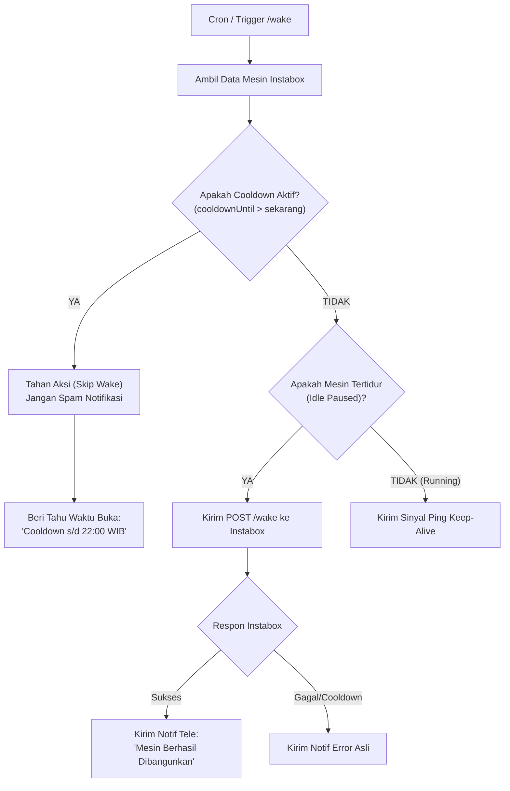

# 📋 Rencana Modifikasi: Smart Cooldown Handler, Anti-Spam & Notifikasi Jujur Bot

> **Status:** Draft / Menunggu Persetujuan Pengguna  
> **Tujuan:** Menyempurnakan logika Bot Telegram, Cron Job, dan Dasbor Admin agar cerdas menangani masa **Cooldown 24 Jam** Instabox, tidak memunculkan notifikasi palsu (*false alert*), dan menampilkan informasi waktu tunggu yang transparan dalam zona waktu WIB.

---

## 1. Analisis Masalah Saat Ini

1. **Bug False-Positive pada HTTP 409:**  
   Ketika batas nonstop 8 jam Instabox tercapai, Instabox mengembalikan respon:  
   `HTTP 409 Conflict: {"code": "machine_cooldown", "message": "machine is cooling down until..."}`  
   Kode saat ini menganggap semua respon `409` sebagai "sukses/sedang proses bangun", sehingga Bot Telegram mengirim kabar palsu *"Berhasil dihidupkan"*, padahal mesin terkunci di server Instabox.
2. **Cron Memaksa Wake Saat Cooldown:**  
   Cron tiap 15 menit terus mencoba memanggil `/wake` meskipun mesin sedang masa cooldown 24 jam. Ini memicu loop peringatan palsu di Telegram.
3. **Format Waktu Cooldown Belum Ramah Pengguna:**  
   Waktu `cooldownUntil` masih berformat ISO mentah UTC (`2026-11-03T15:00:35.165895Z`), bukan waktu Indonesia (WIB) dengan hitung mundur (*countdown*).

---

## 2. Rincian Modifikasi yang Akan Dilakukan

### A. Helper API Instabox (`lib/instabox.ts`)
1. **Deteksi Khusus `machine_cooldown` pada `wakeInstaboxMachine()`:**
   * Cek error code spesifik dari Instabox API.
   * Jika kodenya `machine_cooldown`, kembalikan:
     ```ts
     {
       success: false,
       isCooldown: true,
       cooldownUntil: string, // waktu berakhir
       message: 'Mesin sedang dalam masa istirahat (cooldown)...'
     }
     ```
2. **Cek Cooldown di `runInstaboxKeepAlive()` (Smart Guard):**
   * Sebelum melakukan ping atau wake, sistem mengecek nilai `machine.cooldownUntil`.
   * Jika waktu cooldown masih aktif (`cooldownUntil > Date.now()`):
     * **Batalkan pemanggilan `/wake` ke Instabox** (hemat request & hindari error).
     * Kembalikan `actionTaken: 'skipped_cooldown'`.
     * **Jangan kirim notifikasi bangun ke Telegram**.

### B. Endpoint Cron (`app/api/cron/instabox-keepalive/route.ts`)
* Jika cron mendeteksi status `skipped_cooldown`, cron akan hening (tidak mengirim spam alert ke Telegram).
* Respon JSON akan menjelaskan:
  ```json
  {
    "success": true,
    "action": "skipped_cooldown",
    "cooldownUntil": "2026-11-03T15:00:35Z",
    "message": "Mesin sedang cooldown hingga 03 Nov 2026 22:00 WIB. Auto-wake dilewati."
  }
  ```

### C. Bot Telegram (`app/api/telegram/webhook/route.ts`)
1. **Pesan Format Baru saat Cooldown:**
   * Jika pengguna menekan tombol **`[⚡ Bangunkan (Wake Up)]`** atau mengetik **`/wake`** saat mesin sedang cooldown:
     Bot membalas secara transparan:
     ```text
     ⚠️ MESIN SEDANG MASA ISTIRAHAT (COOLDOWN)
     ━━━━━━━━━━━━━━━━━━━━━━━━━━━━
     Mesin Hermes telah mencapai batas penggunaan nonstop harian (8 jam).

     ⏳ Bisa Dibangunkan Kembali Pada:
     🗓️ Selasa, 3 November 2026
     ⏰ Pukul 22:00 WIB
     ⏱️ Sisa Waktu: Sekitar 16 Jam 30 Menit lagi

     💡 Tips: Setelah masa cooldown selesai, gunakan Hermes secara on-demand agar kuota harian tidak cepat habis.
     ```
2. **Format Waktu di Menu `/vps`:**
   * Mengubah format `cooldownUntil` dari string UTC menjadi bahasa Indonesia yang ramah (contoh: `Selasa, 3 Nov, 22:00 WIB (⏳ Sisa 16j 30m)`).

### D. Halaman Dasbor Admin (`app/admin/instabox/InstaboxClientView.tsx`)
1. **Banner Peringatan Cooldown Aktif:**
   * Jika mesin sedang cooldown, tampilkan banner alert kuning di atas tombol kontrol:  
     `⚠️ Mesin Hermes Sedang Masa Cooldown 24 Jam Sampai [Jam:Menit WIB]. Tombol Wake dinonaktifkan sementara.`
2. **Proteksi Tombol Wake:**
   * Memberikan konfirmasi peringatan jika admin tetap ingin mencoba menekan tombol wake saat cooldown.

---

## 3. Alur Logika Baru (Flowchart)



---

## 4. Rencana File yang Dimodifikasi

| File | Bagian yang Dimodifikasi |
|---|---|
| `lib/instabox.ts` | Tambah helper format tanggal WIB, cek cooldown guard di `runInstaboxKeepAlive`, dan perbaikan status 409 di `wakeInstaboxMachine`. |
| `app/api/cron/instabox-keepalive/route.ts` | Tambah penanganan `skipped_cooldown` agar tidak mengirim false-alert. |
| `app/api/telegram/webhook/route.ts` | Perbaiki respon perintah `/wake` dan tampilan `/vps` dengan tanggal & sisa waktu WIB. |
| `app/admin/instabox/InstaboxClientView.tsx` | Tambah banner Cooldown Alert dan format countdown di kartu Uptime. |

---

> Rencana ini siap dijalankan setelah Anda konfirmasi setuju. Silakan beri tahu jika ada penyesuaian yang diinginkan!

