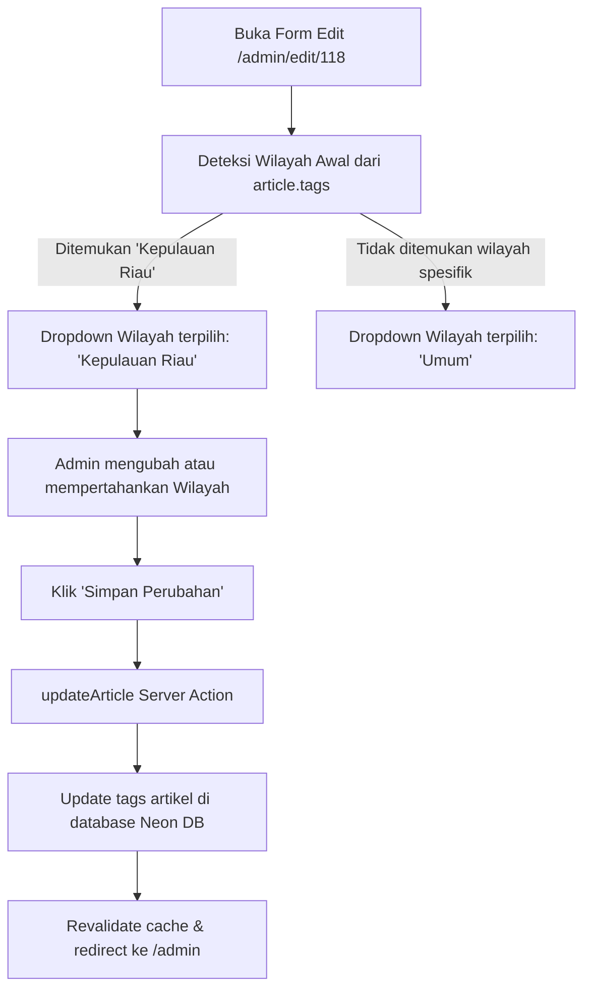

# Rencana Fitur Kategori Wilayah di Form Edit Admin

Dokumen ini merinci rencana penambahan kontrol **Kategori Wilayah (Provinsi Liputan)** pada halaman form edit admin (`/admin/edit/[id]`) khusus saat kategori dipilih **Regional**, beserta perbaikan logika deteksi wilayah di portal publik.

---

## 1. Latar Belakang & Masalah Saat Ini

1. **Ketiadaan Input Wilayah di Form Edit**:
   - Di `app/admin/edit/[id]/EditForm.tsx`, input kategori hanya berupa dropdown 6 kategori (`Software`, `Hardware`, `AI`, `Infrastruktur`, `Gadget`, `Regional`) tanpa opsi pemilihan wilayah provinsi.
2. **Kasus Berita Pemuda/Mahasiswa Kundur (Karimun)**:
   - Artikel ID **118** (*"Mahasiswa Kundur Desak Pemkab Karimun Bertindak, Keselamatan Dermaga Tanjungbatu Jadi Sorotan"*) di database sudah memiliki tag `Kepulauan Riau`.
   - Namun di kartu berita publik `app/(public)/KabarNusantaraSection.tsx`, artikel ini salah tampil sebagai **"Riau"**. Hal ini terjadi karena urutan pengecekan regex kata `Riau` dieksekusi lebih dulu daripada `Kepulauan Riau`.

---

## 2. Desain Letak & Struktur Layout

### A. Tampilan Desktop (Grid 2 Kolom)

Kontrol wilayah diletakkan di dalam kolom **Kategori Berita**, sehingga tidak merusak perataan grid dengan *Slug URL*, *Waktu Tayang*, dan *Penulis*.

```
┌────────────────────────────────────────────────────────────────────────┐
│ Judul Artikel *                                                        │
│ [ Mahasiswa Kundur Desak Pemkab Karimun Bertindak...                 ] │
├────────────────────────────────────┬───────────────────────────────────┤
│ Slug URL *                         │ Kategori Berita *                 │
│ [ mahasiswa-kundur-desak-pemkab..] │ [ Regional                      ▼]│
│ URL: /berita/regional/118/...      │ ┌───────────────────────────────┐ │
│                                    │ │ 📍 Wilayah Liputan Daerah     │ │
│                                    │ │ [ Kepulauan Riau            ▼]│ │
│                                    │ └───────────────────────────────┘ │
├────────────────────────────────────┼───────────────────────────────────┤
│ Waktu Tayang (Local Time) *        │ Penulis *                         │
│ [ 2026-10-21T12:00               ] │ [ Redaksi                       ▼]│
└────────────────────────────────────┴───────────────────────────────────┘
```

> **Catatan UX**:
> * Jika Kategori = **Regional**, kotak sub-selector wilayah muncul dengan transisi halus (`animate-in fade-in`).
> * Jika Kategori diganti ke kategori lain (misal: *AI* atau *Software*), kotak sub-selector wilayah otomatis disembunyikan.

---

### B. Tampilan Mobile (Responsif 1 Kolom)

Pada layar smartphone, form tersusun berurutan ke bawah:

```
┌────────────────────────────────────────┐
│ Judul Artikel *                        │
│ [ ... ]                                │
├────────────────────────────────────────┤
│ Slug URL *                             │
│ [ ... ]                                │
├────────────────────────────────────────┤
│ Kategori Berita *                      │
│ [ Regional                           ▼]│
│                                        │
│   ┌──────────────────────────────────┐ │
│   │ 📍 Wilayah Liputan Daerah        │ │
│   │ [ Kepulauan Riau               ▼]│ │
│   │ Pilihan: 38 Provinsi Indonesia   │ │
│   └──────────────────────────────────┘ │
├────────────────────────────────────────┤
│ Waktu Tayang *                         │
│ [ ... ]                                │
├────────────────────────────────────────┤
│ Penulis                                │
│ [ ... ]                                │
└────────────────────────────────────────┘
```

---

## 3. Daftar Wilayah (38 Provinsi & Opsi Umum)

Menggunakan daftar standar provinsi Indonesia yang konsisten dengan halaman generator:

```typescript
export const INDONESIA_REGIONS = [
  'Umum',
  // Kepulauan Riau & Riau
  'Kepulauan Riau',
  'Riau',
  // Sumatera
  'Sumatera Utara', 'Sumatera Barat', 'Sumatera Selatan', 'Aceh', 'Lampung', 'Jambi', 'Bengkulu', 'Bangka Belitung',
  // Jawa & Bali
  'DKI Jakarta', 'Jawa Barat', 'Jawa Tengah', 'DI Yogyakarta', 'Jawa Timur', 'Banten', 'Bali',
  // Nusa Tenggara
  'Nusa Tenggara Barat', 'Nusa Tenggara Timur',
  // Kalimantan
  'Kalimantan Barat', 'Kalimantan Tengah', 'Kalimantan Selatan', 'Kalimantan Timur', 'Kalimantan Utara',
  // Sulawesi
  'Sulawesi Selatan', 'Sulawesi Utara', 'Sulawesi Tengah', 'Sulawesi Tenggara', 'Gorontalo', 'Sulawesi Barat',
  // Maluku & Papua
  'Maluku', 'Maluku Utara', 'Papua', 'Papua Barat', 'Papua Selatan', 'Papua Tengah', 'Papua Pegunungan', 'Papua Barat Daya'
];
```

---

## 4. Alur Kerja Data (Data Flow)



### Mekanisme Sinkronisasi Tags:
1. **Saat Load Form**:
   Sistem memeriksa array `article.tags`. Jika mengandung salah satu nama provinsi (contoh `"Kepulauan Riau"`), nilai state `selectedRegion` otomatis diset ke `"Kepulauan Riau"`.
2. **Saat Submit Form**:
   Nilai wilayah dikirim melalui `formData.set('region', selectedRegion)`. Di server action `updateArticle`, jika kategori adalah `Regional` dan `region !== 'Umum'`:
   - Menghapus tag provinsi lama yang berkonflik (jika ada).
   - Menambahkan tag wilayah terpilih ke dalam daftar `tags`.
   - Data tersimpan rapi tanpa perlu mengubah struktur tabel database.

---

## 5. Perbaikan Bug Deteksi Badge di Tampilan Publik

Pada file `app/(public)/KabarNusantaraSection.tsx`:

1. **Ubah urutan pengecekan**:
   Tempatkan `Kepulauan Riau` **sebelum** `Riau`.
2. **Perkaya pola pencocokan (Regex)**:
   ```typescript
   // Kepulauan Riau dicek LEBIH DULU:
   { 
     label: 'Kepulauan Riau', 
     pattern: /\b(kepri|kepulauan riau|batam|tanjungpinang|karimun|kundur|bintan|lingga|natuna|anambas)\b/i 
   },
   // Riau dicek setelah Kepulauan Riau:
   { 
     label: 'Riau', 
     pattern: /\b(riau|pekanbaru|dumai|siak|kampar|bengkalis|rohil|rohul|inhil|inhu|pelalawan|meranti)\b/i 
   },
   ```
   Dengan perbaikan ini, berita yang mengandung kata *Karimun*, *Kundur*, *Batam*, *Tanjungpinang*, atau *Kepulauan Riau* dijamin 100% dideteksi sebagai **Kepulauan Riau**, bukan Riau.

---

## 6. Ruang Lingkup File yang Diubah (Hanya 3 File)

Perubahan dijaga sangat spesifik dan minimalis agar tidak meleber:

| No | File | Tujuan Perubahan |
|----|------|-------------------|
| 1 | `app/admin/edit/[id]/EditForm.tsx` | Menambahkan dropdown wilayah kondisional jika kategori = Regional |
| 2 | `app/admin/actions.ts` | Membaca field `region` dan menyinkronkannya ke array `tags` artikel |
| 3 | `app/(public)/KabarNusantaraSection.tsx` | Memperbaiki prioritas urutan Kepulauan Riau vs Riau |

---

## 7. Status Eksekusi

✅ **Selesai Diimplementasikan dan Terverifikasi**:
1. Form edit admin ([EditForm.tsx](file:///e:/porto/naratif/app/admin/edit/%5Bid%5D/EditForm.tsx)) kini memiliki sub-selector wilayah untuk kategori Regional.
2. Server action ([actions.ts](file:///e:/porto/naratif/app/admin/actions.ts)) menyinkronkan wilayah ke tags artikel.
3. Pendeteksian badge wilayah publik ([KabarNusantaraSection.tsx](file:///e:/porto/naratif/app/%28public%29/KabarNusantaraSection.tsx)) telah memprioritaskan *Kepulauan Riau* di atas *Riau* dan teruji menghasilkan label **Kepulauan Riau**.
