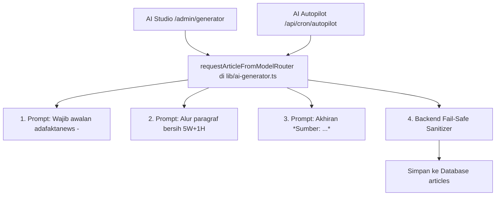

# RENCANA KERJA (PLAN): PENYELARASAN FORMAT BERSIH AI STUDIO & AUTOPILOT

> Dokumen perencanaan teknis untuk menyelaraskan format naskah berita di **AI Studio** dan **AI Autopilot** agar memiliki format clean, profesional, dan seragam dengan **Meja Redaksi Jurnalis**.

---

## 1. Latar Belakang & Tujuan

Saat ini, format artikel hasil generasi di **Meja Redaksi Jurnalis** memiliki tampilan yang sangat bersih, rapi, dan mudah dibaca:
1. **Awalan Khas**: Selalu dibuka dengan dateline `adafaktanews - ` di kalimat pertama.
2. **Alur Jurnalistik Mengalir (5W+1H)**: Paragraf lead, penjelasan fakta/konteks, dampak bagi publik, dan penutup status terkini tanpa pemecah subjudul/bullet-points yang berlebihan.
3. **Atribusi Sumber Miring**: Ditutup dengan satu baris sederhana di bagian bawah: `*Sumber: [nama sumber media]*`.

**Tujuan Rencana Ini**:
Menerapkan standar format yang sama persis ke **AI Studio** (`/admin/generator`) dan **AI Autopilot** (`/api/cron/autopilot`) agar seluruh portal berita AdaFakta memiliki keseragaman brand (*One Voice & Clean Aesthetic*).

---

## 2. Struktur Format Berita Baru

```markdown
adafaktanews - [Kalimat pembuka peristiwa inti / lead terhangat]...

[Paragraf penjelasan latar belakang kejadian, kutipan narasumber, dan kronologi]...

[Paragraf analisis dampak peristiwa bagi masyarakat, industri, atau sektor terkait]...

[Paragraf penutup yang merangkum status terkini peristiwa]...

*Sumber: [Nama media/sumber referensi berita]*
```

---

## 3. Titik Perubahan Teknis (Centralized Engine)

Berita di **AI Studio** dan **AI Autopilot** sama-sama diproses melalui satu fungsi sentral:
`requestArticleFromModelRouter()` di file `lib/ai-generator.ts`.

Dengan memperbarui file ini, kedua fitur langsung otomatis mendapatkan pembaruan format:



---

## 4. Tahapan Pengerjaan Rinci (Step-by-Step)

### Tahap 1: Pembaruan System Prompt di `lib/ai-generator.ts`
1. **Untuk Kategori Teknologi / Umum**:
   - Menghapus kewajiban menggunakan banyak subjudul Markdown (`##`, `###`) dan bullet points yang kaku.
   - Mengubah pedoman penulisan agar berbentuk narasi jurnalistik mengalir yang padat dan enak dibaca.
   - Menetapkan aturan wajib: Paragraf pertama harus diawali langsung dengan teks `adafaktanews - `.
   - Menetapkan aturan wajib: Baris paling akhir naskah berita harus ditutup dengan `*Sumber: [nama media/sumber referensi]*` dalam tulisan miring.
2. **Untuk Kategori Regional / Daerah**:
   - Menerapkan aturan yang sama: diawali `adafaktanews - ` dan diakhiri `*Sumber: ...*`.

### Tahap 2: Pemasangan Fail-Safe Sanitizer di Backend
Untuk menjamin 100% kepatuhan format meskipun AI sesekali terlewat:
1. **Pengecekan Awalan**:
   - Jika `content` belum diawali dengan `adafaktanews - `, sistem secara otomatis membersihkan awalan lama dan menyematkan `adafaktanews - ` di depan kalimat pertama.
2. **Pengecekan Akhiran**:
   - Jika `content` belum memuat baris `*Sumber:`, sistem secara otomatis mengambil nama media dari hasil riset Google News atau rujukan topik dan menyematkan `\n\n*Sumber: [Nama Sumber]*` di baris terakhir.

### Tahap 3: Pengujian & Validasi
1. Menjalankan skrip simulasi pemanggilan AI untuk memverifikasi struktur teks yang dihasilkan.
2. Memastikan tidak ada error TypeScript dengan `npx tsc --noEmit`.
3. Memastikan `npm run build` tetap lolos 100%.

### Tahap 4: Deployment ke GitHub & Vercel
1. Melakukan `git add`, `git commit`, dan `git push` ke branch `main`.
2. Memastikan Vercel berhasil mem-build dan men-deploy pembaruan.

---

## 5. Dampak Bagi Redaksi & Pengguna

- **Di AI Studio**: Ketika redaktur memasukkan topik berita apa saja, naskah yang muncul di editor langsung rapi berawalan `adafaktanews - ` dan bersumber miring di bawah.
- **Di Autopilot**: Berita otomatis yang terbit di jam-jam cron terjadwal akan tampil dengan gaya jurnalisme yang seragam dan elegan tanpa perlu diedit manual lagi.
