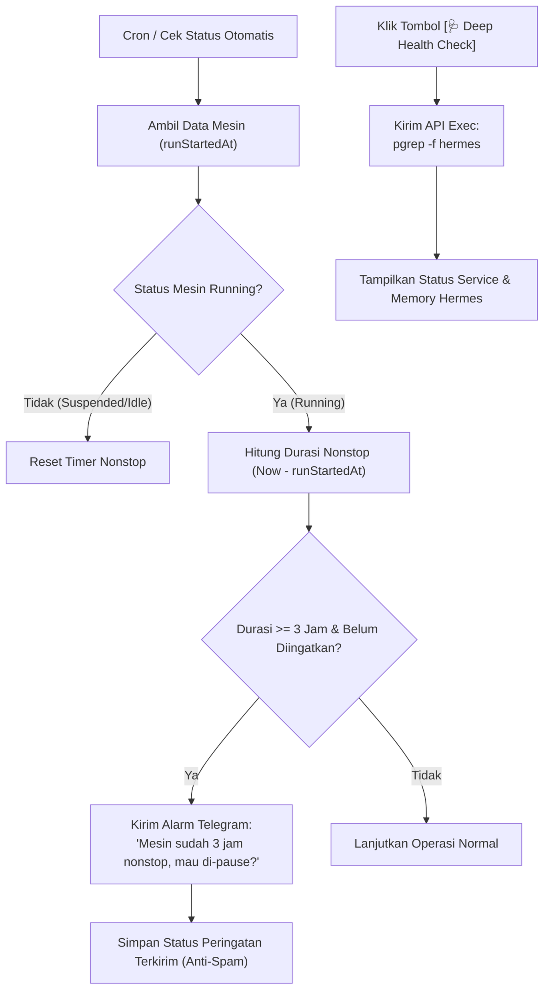

# 📋 Rancangan Fitur (Bagian 1): Hermes VPS Smart Guard & Health Monitor

> **Status:** Draft Perencanaan / Menunggu Persetujuan  
> **Ruang Lingkup:** Bagian 1 — Proteksi Kuota Harian, Alarm Pengingat Nonstop Telegram (3 Jam), dan Hermes Service Health Check.  
> **Prinsip:** Tidak ada kode produksi yang diimplementasikan sebelum rancangan ini disetujui.

---

## 1. Latar Belakang & Tujuan

Berdasarkan pengalaman hari ini, mesin Instabox Free Tier memiliki limit:
1. **Continuous Runtime:** Maksimal 480 menit (8 jam nonstop).
2. **Penalti Cooldown:** Jika tembus 8 jam nonstop, mesin dikunci selama 24 jam.
3. **Problem Utama Pengguna:** Sering lupa mematikan/pause mesin setelah selesai digunakan, serta tidak tahu apakah aplikasi Hermes di dalam VPS benar-benar sudah siap melayani atau belum.

**Tujuan Bagian 1:**
* Memberikan visualisasi **Progress Bar Kuota Harian** (0 – 8 Jam) di web admin agar pengguna tahu sisa waktu yang tersedia.
* Mengirim **Alarm Pengingat Otomatis via Telegram** jika Hermes sudah menyala selama **3 Jam nonstop**, lengkap dengan tombol 1-klik `[⏸️ Pause Sekarang]` dari chat HP.
* Menghadirkan **Hermes Service Health Check** untuk memastikan script/service Hermes di dalam VPS benar-benar berstatus hidup (bukan sekadar mesin Linux-nya yang nyala).

---

## 2. Rincian 3 Fitur Utama

### A. Progress Bar Kuota Harian (Daily Runtime Tracker)
1. **Cara Perhitungan:**
   * Diambil dari properti `cost.freeSandboxHours` pada endpoint `/v1/usage` Instabox, atau dihitung dari akumulasi jam aktif hari ini.
   * `Total Kuota:` 8.0 Jam (480 Menit).
   * `Pemakaian Hari Ini:` misal 3.2 Jam.
   * `Sisa Waktu:` 4.8 Jam lagi.
2. **Visualisasi Desain (Indikator Warna Cerdas):**
   * 🟢 **Aman (< 4 Jam / < 50%):** Bar berwarna hijau zamrud (`bg-emerald-500`).
   * 🟡 **Peringatan (4 – 6.5 Jam / 50%–80%):** Bar berwarna kuning/oranye (`bg-amber-500`).
   * 🔴 **Kritis (> 6.5 Jam / > 80%):** Bar berwarna merah (`bg-rose-500`) dengan teks kedip *Hampir Habis*.

```text
[ Wireframe Progress Bar di Admin ]
+---------------------------------------------------------------------------------+
| ⏱️ PENGGUNAAN KUOTA HARIAN FREE TIER                                            |
| 3.5 / 8.0 Jam Digunakan (43%)                           Sisa Kuota: 4.5 Jam      |
| [====================---------------------------------]                         |
| 🟢 Status: Aman — Mesin dapat digunakan dengan leluasa hari ini                 |
+---------------------------------------------------------------------------------+
```

---

### B. Alarm Pengingat Nonstop Telegram (3-Jam Warning Guard)
1. **Cara Kerja:**
   * Instabox menyediakan properti `runStartedAt` (waktu kapan mesin terakhir mulai hidup).
   * Sistem menghitung durasi: `Durasi = Waktu Sekarang - runStartedAt`.
   * Jika mesin sudah menyala terus-menerus selama **≥ 3 Jam (180 Menit)**:
     * Bot Telegram otomatis mengirim pesan peringatan ke HP Anda.
     * **Sistem Anti-Spam:** Notifikasi ini hanya dikirim **1 kali per sesi menyala** (disimpan flag session ID di database agar HP Anda tidak dibanjiri chat).
2. **Format Pesan Telegram:**
   ```text
   🔔 PENGINGAT DURASI AKTIF HERMES VPS
   ━━━━━━━━━━━━━━━━━━━━━━━━━━━━
   Mesin Hermes sudah menyala nonstop selama:
   ⏱️ 3 Jam 15 Menit

   📊 Kuota Harian: 4.2 / 8.0 Jam (Sisa: 3.8 Jam)

   💡 Jika pekerjaan dengan Hermes sudah selesai, tekan tombol di bawah untuk menidurkan mesin agar kuota harian Anda tetap aman dan tidak kena cooldown 24 jam!

   [ ⏸️ Pause / Tidurkan Mesin Sekarang ]   [ 🖥️ Cek Status ]
   ```

---

### C. Hermes Service Health Check (Deep App Probe)
1. **Masalah yang Diselesaikan:**
   * Saat status mesin `RUNNING`, itu hanya berarti sistem operasi Linux Ubuntu/Debian di Instabox aktif.
   * Terkadang script Hermes AI belum selesai loading, mengalami crash, atau port-nya belum siap.
2. **Solusi Teknis:**
   * Sistem mengirim perintah pemeriksaan via API `exec`:
     * Mengecek proses berjalan: `pgrep -f hermes || ps aux | grep -i hermes | grep -v grep`
     * Atau mengecek port web/API Hermes: `curl -s -I http://localhost:PORT | head -n 1`
3. **Tampilan di Admin & Telegram:**
   * Status Mesin VM: `🟢 RUNNING`
   * Status Service Hermes: `🟢 ACTIVE & READY` (atau `🟡 STARTING / OFFLINE`)
   * Tombol Aksi: `[🩺 Deep Health Check]`

---

## 3. Alur Komunikasi Sistem (Flowchart)



---

## 4. File-File yang Akan Dimodifikasi

1. **`lib/instabox.ts`:**
   * Tambah fungsi kalkulasi pemakaian jam harian & sisa kuota (`getDailyUsageStats()`).
   * Tambah fungsi pengecekan kesehatan service Hermes (`checkHermesServiceHealth()`).
   * Tambah logika proteksi alarm 3 jam di `runInstaboxKeepAlive()`.
2. **`app/admin/instabox/actions.ts`:**
   * Tambah server action `getHermesHealthAction()`.
3. **`app/admin/instabox/InstaboxClientView.tsx`:**
   * Tambah komponen visual **Progress Bar Kuota Harian** (8 Jam).
   * Tambah status badge **Hermes App Health**.
4. **`app/api/telegram/webhook/route.ts`:**
   * Tambah tombol aksi cepat `vps:pause` langsung dari chat Telegram jika user ingin mematikan mesin dari pesan pengingat.

---

> Rencana ini fokus pada **Bagian 1**. Silakan diperiksa detailnya, dan beri tahu saya jika Anda ingin melakukan penyesuaian atau sudah siap untuk dieksekusi!

