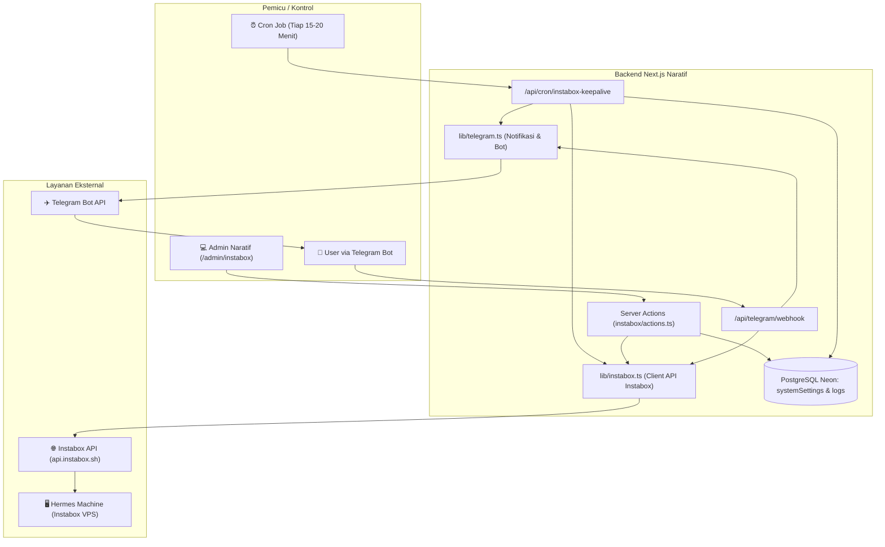

# 📋 Rencana Implementasi: Instabox VPS Manager, Auto Keep-Alive & Telegram Bot

> **Status:** Draft / Menunggu Persetujuan Pengguna  
> **Target:** Menjaga Hermes VPS (Instabox Free Tier) tetap online 24/7, dashboard kontrol di Admin Naratif, dan remote control via Telegram Bot.  
> **Prinsip Utama:** Tidak ada kode produksi yang diimplementasikan sebelum rencana ini disetujui.

---

## 1. Latar Belakang & Analisis Masalah

1. **Karakteristik Instabox Free Tier:**
   * Mesin akan otomatis masuk status **Idle Pause (Auto-Suspend)** setelah 30 menit tidak ada aktivitas/traffic.
   * **Kabar Baik dari Dokumentasi Resmi:** *Idle Pause* **tidak memiliki waktu tunggu (cooldown)** sama sekali. Mesin bisa langsung dibangunkan (*resume/wake*) seketika.
   * Free tier memiliki batas *Continuous Max Run* hingga 480 menit (8 jam) sebelum cooldown 5–20 menit. Maka dari itu, menjaga mesin aktif dengan trigger berkala sebelum 30 menit adalah solusi terbaik untuk menjaga Hermes selalu aktif.
2. **Kebutuhan Pengguna:**
   * **Auto Keep-Alive / Wake:** Mencegah mesin tertidur atau segera membangunkannya kembali secara otomatis via Cron Job.
   * **Halaman Admin Naratif (`/admin/instabox`):** Dashboard elegan untuk cek status live, tombol manual Wake/Start, generator SSH token sekali klik, dan mini terminal untuk menjalankan perintah `exec`.
   * **Remote Control Telegram Bot:** Kontrol penuh dari smartphone (cek `/status`, bangunkan `/wake`, eksekusi perintah `/exec`, dan menerima alert jika mesin sempat tertidur lalu berhasil dibangunkan).

---

## 2. Arsitektur & Alur Data



---

## 3. Desain UI/UX & Struktur Tampilan Halaman Admin

Halaman baru: `app/admin/instabox/page.tsx`  
Tema visual mengikuti Design System Admin Naratif:
* **Background & Cards:** Slate/Gray light theme (`bg-gray-50`), kartu putih (`bg-white rounded-2xl border border-gray-100 shadow-sm p-6`).
* **Warna Aksen:** Indigo-600 sebagai primary (`bg-indigo-600 hover:bg-indigo-500 text-white`).
* **Status Badges:**
  * 🟢 **Running / Active:** `bg-emerald-50 text-emerald-700 border-emerald-200`
  * 🟡 **Suspended / Idle Paused:** `bg-amber-50 text-amber-700 border-amber-200`
  * 🔴 **Stopped / Cooldown:** `bg-rose-50 text-rose-700 border-rose-200`
* **Icons:** `lucide-react` (`Server`, `Terminal`, `KeyRound`, `Activity`, `Power`, `Send`, `RefreshCw`, `Clock`, `ShieldCheck`).

### Wireframe / Layout Struktur Halaman:

```text
+---------------------------------------------------------------------------------------------------------+
| [Header] 🖥️ VPS Instabox & Hermes Hub                   [🔄 Refresh Data]  [⚡ Wake Up Sekarang]       |
| Status koneksi API: Terhubung | Mesin: Hermes-01 (m_agqte...) | Terakhir Aktif: 2 menit lalu           |
+---------------------------------------------------------------------------------------------------------+

+--------------------+  +--------------------+  +--------------------+  +--------------------+
| 🟢 Status Mesin    |  | ⏱️ Sisa Uptime     |  | ⏰ Auto Keep-Alive |  | 🤖 Telegram Bot    |
| RUNNING            |  | 412 / 480 Menit    |  | AKTIF (Tiap 15m)   |  | TERHUBUNG          |
| IP: 185.xxx.xxx    |  | Cooldown: Tidak    |  | Last: 12:15 WIB    |  | Chat ID: 62812xxx  |
+--------------------+  +--------------------+  +--------------------+  +--------------------+

+-------------------------------------------------------------+ +-----------------------------------------+
| [KOLOM UTAMA: KONTROL & TERMINAL]                           | | [KOLOM KANAN: STATUS CRON & LOGS]       |
|                                                             | |                                         |
| 1. KONTROL CEPAT MESIN                                      | | 1. PENGATURAN AUTO-WAKE (CRON)          |
|    - [ ⚡ Wake Up / Resume ]   [ 🔄 Restart ]  [ ⏸️ Suspend] | |    - Toggle: [ Aktif / Nonaktif ]       |
|                                                             | |    - Interval Cron: 15 Menit            |
| 2. ONE-CLICK SSH LOGIN                                      | |    - Webhook URL Cron:                  |
|    - [ 🔑 Generate Token SSH Baru ]                         | |      `https://domain/api/cron/...`      |
|    - Command siap salin:                                    | |    - [ Test Cron Sekarang ]             |
|      `ssh -p 2222 ibssh_r2kd... @api.instabox.sh` [📋 Copy] | |                                         |
|                                                             | | 2. TELEGRAM BOT SETTINGS & TEST         |
| 3. MINI TERMINAL / EXEC BASH                                | |    - Notif saat Auto-Wake: [ Aktif ]    |
|    - Menjalankan perintah remote via API tanpa buka SSH     | |    - [ 📲 Kirim Pesan Uji Coba ]        |
|    - Input: [ ps aux | grep hermes            ] [ Kirim ]   | |                                         |
|    - Output Console (Terminal hitam):                       | | 3. RIWAYAT LOG AKTIVITAS                |
|      +----------------------------------------------------+ | |    - [12:15] Auto-wake sukses (HTTP 200)|
|      | $ ps aux | grep hermes                             | | |    - [12:00] Mesin aktif, status check  |
|      | root 1421  0.2  1.4  124892  hermes-engine run     | | |    - [11:45] Auto-wake sukses           |
|      +----------------------------------------------------+ | |    - [11:30] Manual wake by Admin       |
+-------------------------------------------------------------+ +-----------------------------------------+
```

---

## 4. Rincian Fitur & Mekanisme Kerja

### A. Strategi Keep-Alive (Cron Otomatis)
1. **Target:** Mencegah timer 30 menit Instabox habis agar Hermes tidak ter-suspend.
2. **Cara Kerja:**
   * Cron eksternal (cron-job.org atau Vercel Cron) memanggil endpoint:
     `POST /api/cron/instabox-keepalive` dengan header `Authorization: Bearer <CRON_SECRET>`.
   * Endpoint menjalankan logika berikut:
     1. Panggil `GET https://api.instabox.sh/v1/machines/{id}` untuk melihat status saat ini.
     2. Jika status adalah `suspended` atau `paused`, segera kirim:
        `POST https://api.instabox.sh/v1/machines/{id}/wake` dengan `Idempotency-Key`.
     3. Jika status masih `running`, panggil eksekusi ringan via `/exec` (misal: `echo keepalive`) untuk me-reset timer idle 30 menit.
     4. Jika opsi notifikasi Telegram aktif, kirim pesan rekap jika ada kejadian mesin sempat tertidur.
     5. Simpan catatan timestamp eksekusi ke `systemSettings` di database.

### B. Integrasi Telegram Bot (Interaktif 2-Arah)
1. **Endpoint Webhook:** `/api/telegram/webhook`
2. **Daftar Perintah (Commands):**
   * `/status` &rarr; Cek status realtime Instabox (Running / Suspended, memory, IP, uptime).
   * `/wake` &rarr; Bangunkan mesin Instabox secara instan.
   * `/restart` &rarr; Restart mesin Instabox.
   * `/ssh` &rarr; Generate SSH token instan dan kirimkan string perintah `ssh -p 2222 ...` yang bisa langsung disalin di Termius / terminal HP.
   * `/exec <command>` &rarr; Eksekusi perintah Linux di mesin Hermes dan kembalikan output teksnya ke chat Telegram.
   * `/ping` &rarr; Cek respon Hermes service.
   * `/help` &rarr; Tampilkan panduan perintah.
3. **Fitur Keamanan Bot:**
   * Bot hanya merespon `chat_id` milik Anda (whitelist ID). Orang asing yang mengirim pesan ke bot otomatis diabaikan (*unauthorized*).

### C. Halaman Dashboard Admin Naratif
1. **Penambahan Menu Sidebar:**
   * Di file `app/admin/AdminLayoutClient.tsx`, tambahkan item navigasi:
     ```tsx
     {
       label: 'VPS Instabox',
       href: '/admin/instabox',
       icon: Server,
     }
     ```
2. **Server Actions (`app/admin/instabox/actions.ts`):**
   * `getInstaboxMachineStatus()`: Mengambil info detail mesin dari Instabox API.
   * `wakeInstaboxMachineAction()`: Menghidupkan/membangunkan mesin.
   * `executeMachineCommandAction(cmd: string)`: Menjalankan bash command di mesin via `/v1/machines/{id}/exec`.
   * `generateSshTokenAction()`: Memanggil endpoint `/v1/machines/{id}/ssh-tokens`.
   * `testTelegramNotificationAction()`: Uji coba kirim pesan Telegram.
   * `saveInstaboxConfigAction(data)`: Menyimpan ID mesin / setting keepalive ke database.

---

## 5. File yang Akan Dibuat & Dimodifikasi (Saat Eksekusi)

| No | Tipe | Path File | Fungsi |
|---|---|---|---|
| 1 | **Baru** | `lib/instabox.ts` | Helper client API Instabox (fetch wrapper, wake, get, exec, ssh-tokens, idempotency). |
| 2 | **Baru** | `lib/telegram.ts` | Helper Bot Telegram (sendMessage, format pesan HTML/Markdown, validasi chat ID). |
| 3 | **Baru** | `app/api/cron/instabox-keepalive/route.ts` | Endpoint handler Cron Job untuk auto-wake & ping. |
| 4 | **Baru** | `app/api/telegram/webhook/route.ts` | Endpoint Webhook Telegram untuk menangani chat & command. |
| 5 | **Baru** | `app/admin/instabox/page.tsx` | Halaman server component dasbor VPS. |
| 6 | **Baru** | `app/admin/instabox/InstaboxClientView.tsx` | Komponen interaktif: kontrol mesin, SSH modal, mini terminal console. |
| 7 | **Baru** | `app/admin/instabox/actions.ts` | Server actions untuk operasi Instabox & Telegram. |
| 8 | **Ubah** | `app/admin/AdminLayoutClient.tsx` | Menambahkan menu "VPS Instabox" ke sidebar navigasi admin. |
| 9 | **Ubah** | `.env.local` | Konfigurasi API keys (`INSTABOX_API_KEY`, `INSTABOX_MACHINE_ID`, `TELEGRAM_BOT_TOKEN`, `TELEGRAM_ALLOWED_CHAT_ID`, `CRON_SECRET`). |

---

## 6. Variabel Environment Baru (`.env.local`)

```env
# Instabox Configuration
INSTABOX_API_KEY="ibk_..."
INSTABOX_API_URL="https://api.instabox.sh"
INSTABOX_MACHINE_ID="m_..."

# Telegram Bot Integration
TELEGRAM_BOT_TOKEN="1234567890:ABCdefGhI..."
TELEGRAM_ALLOWED_CHAT_ID="123456789" # ID Telegram pribadi Anda

# Cron Security
CRON_SECRET="naratif_cron_secret_..."
```

---

## 7. Tahapan Eksekusi Bertahap (Roadmap)

* [ ] **Fase 1: Persiapan Helper & API Client**
  * Buat `lib/instabox.ts` (teruji dengan API Key & Machine ID Anda).
  * Buat `lib/telegram.ts` untuk kirim notifikasi.
* [ ] **Fase 2: Pembuatan API Cron Keep-Alive**
  * Buat endpoint `/api/cron/instabox-keepalive`.
  * Uji fungsionalitas auto-wake saat mesin dalam keadaan paused.
* [ ] **Fase 3: Integrasi Telegram Bot (Webhook & Commands)**
  * Daftarkan webhook Telegram ke domain/API Anda.
  * Uji command `/status`, `/wake`, `/exec`, `/ssh`.
* [ ] **Fase 4: Pembangunan Halaman Admin (`/admin/instabox`)**
  * Buat tampilan UI elegan dengan Tailwind CSS & Lucide Icons.
  * Buat fitur One-Click SSH Token generator & Mini Terminal Exec.
  * Tambahkan tautan menu di sidebar `AdminLayoutClient.tsx`.
* [ ] **Fase 5: Pengujian Menyeluruh & Verifikasi**
  * Uji alur 30 menit: biarkan mesin paused, pastikan cron membangunkannya dan Telegram menerima laporan sukses.

---

> Rencana ini siap dieksekusi setelah Anda menyetujuinya. Silakan periksa detailnya dan beri tahu jika ada penyesuaian yang diinginkan!

