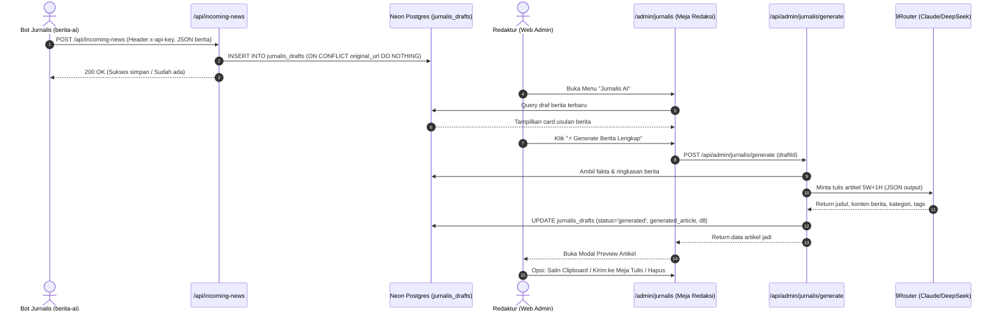

# RENCANA KERJA (PLAN): INTEGRASI FITUR JURNALIS AI ADAFAKTA

> Dokumen perencanaan teknis untuk mengintegrasikan asisten redaksi otomatis (*AI-Assisted Newsroom*) antara Bot Jurnalis (`berita-ai`) dan Web Panel Admin (`adafakta.web.id`).

---

## 1. Ringkasan & Tujuan Fitur

Fitur **Jurnalis AI** menghubungkan bot riset berita otomatis dengan Meja Redaksi AdaFakta:
1. **Penerimaan Otomatis (Ingestion)**: Web panel menerima setoran intelijen berita terhangat dari Bot Jurnalis melalui endpoint API yang aman (`x-api-key`).
2. **Penyimpanan Draf**: Berita masuk dan disimpan ke tabel `jurnalis_drafts` di database Neon Postgres tanpa duplikasi URL.
3. **Meja Redaksi Admin**: Redaktur memiliki halaman khusus `/admin/jurnalis` dengan menu navigasi di sidebar.
4. **Generator Berita 1-Klik**: Redaktur dapat meninjau usulan berita, lalu dengan 1 klik AI menyusun artikel berita utuh (350–500 kata, kaidah 5W+1H, gaya jurnalistik objektif).
5. **Workflow Penerbitan**: Hasil generate dapat disalin ke clipboard atau langsung dikirim ke meja tulis/publikasi artikel live.

---

## 2. Diagram Alur Kerja Sistem



---

## 3. Analisis Kebutuhan Komponen & Gap

| Komponen | Status Saat Ini | Rencana Tindakan |
| :--- | :--- | :--- |
| **Tabel `jurnalis_drafts`** | Belum ada | Tambahkan definisi di `db/schema.ts` (Drizzle ORM) & eksekusi DDL SQL ke Neon Postgres. |
| **Helper DB `sql`** | `db/index.ts` baru ekspor `db` | Ekspor `sql` dari `@neondatabase/serverless` di `db/index.ts` agar mendukung raw query aman dan Drizzle query. |
| **Env `JURNALIS_API_KEY`** | Belum ada di `.env.local` | Tambahkan `JURNALIS_API_KEY=kuncirahasiajurnalis123` dan alias `NINEROUTER_*`. |
| **API `/api/incoming-news`** | Belum ada | Buat `app/api/incoming-news/route.ts` dengan proteksi `x-api-key` dan auto-deduplikasi. |
| **API `/api/admin/jurnalis/generate`** | Belum ada | Buat `app/api/admin/jurnalis/generate/route.ts` menggunakan native fetch OpenAI-compatible (stabil & hemat bundle). |
| **Sidebar Menu Admin** | Belum ada item Jurnalis | Tambahkan menu navigasi "Jurnalis AI" di `app/admin/AdminLayoutClient.tsx`. |
| **Halaman `/admin/jurnalis`** | Belum ada | Buat `app/admin/jurnalis/page.tsx` & `JurnalisClientView.tsx` dengan UI card modern, tab filter, preview modal, dan tombol aksi. |

---

## 4. Tahapan Pengerjaan Rinci (Step-by-Step)

### Tahap 1: Persiapan Database & Environment
1. **Perbarui `db/schema.ts`**:
   - Definisikan tabel `jurnalisDrafts`:
     - `id`: serial primary key
     - `title`: text not null
     - `source`: text not null
     - `originalUrl`: text unique not null
     - `publishedAt`: timestamp with time zone
     - `summary`: text
     - `status`: varchar(50) default 'draft'
     - `generatedTitle`: text
     - `generatedArticle`: text
     - `createdAt`: timestamp defaultNow()
2. **Perbarui `db/index.ts`**:
   - Ekspor instance `sql` neon agar dapat dipakai untuk raw queries jika diperlukan.
3. **Eksekusi Tabel di Neon Postgres**:
   - Jalankan `CREATE TABLE IF NOT EXISTS jurnalis_drafts` ke database aktif.
4. **Perbarui `.env.local`**:
   - Tambahkan `JURNALIS_API_KEY=kuncirahasiajurnalis123`.
   - Tambahkan alias `NINEROUTER_BASE_URL`, `NINEROUTER_API_KEY`, `NINEROUTER_MODEL`.

### Tahap 2: Pembuatan API Ingestion (`/api/incoming-news`)
1. Buat file `app/api/incoming-news/route.ts`.
2. Validasi otentikasi via header `x-api-key` mencocokkan `process.env.JURNALIS_API_KEY`.
3. Validasi payload: `title` dan `url` wajib terisi.
4. Simpan ke database dengan klausa pencegah duplikasi URL (`ON CONFLICT (original_url) DO NOTHING`).
5. Kembalikan response JSON standar `{ success: true, inserted: boolean, message: string }`.

### Tahap 3: Pembuatan Endpoint Generator Berita AI (`/api/admin/jurnalis/generate`)
1. Buat file `app/api/admin/jurnalis/generate/route.ts`.
2. Validasi input: `draftId`.
3. Ambil data draft dari tabel `jurnalis_drafts`.
4. Susun System Prompt jurnalis senior AdaFakta (kaidah 5W+1H, 350-500 kata, objektif, format JSON).
5. Kirim payload ke endpoint OpenAI-compatible (9Router / Claude / DeepSeek) dengan fallback error handling.
6. Parse output JSON AI (`title`, `content`, `category`, `tags`).
7. Update record di `jurnalis_drafts` (`status = 'generated'`, `generated_title`, `generated_article`).
8. Return JSON respons ke client.

### Tahap 4: Penambahan Menu Sidebar Admin
1. Modifikasi `app/admin/AdminLayoutClient.tsx`.
2. Tambahkan entri navigasi:
   ```ts
   {
     label: 'Jurnalis AI',
     href: '/admin/jurnalis',
     icon: Bot, // atau Newspaper
     badge: 'Baru',
   }
   ```
3. Pastikan aktif saat berada di rute `/admin/jurnalis` dan muncul di sidebar desktop maupun drawer mobile.

### Tahap 5: Pembangunan Halaman Meja Redaksi Jurnalis
1. Buat `app/admin/jurnalis/page.tsx` (Server Component):
   - Ambil daftar usulan draf dari database (`ORDER BY created_at DESC LIMIT 100`).
   - Tampilkan judul halaman, badge total usulan, dan panggil `JurnalisClientView`.
2. Buat `app/admin/jurnalis/JurnalisClientView.tsx` (Client Component):
   - **Fitur Filter Tab**: Semua, Draf Mentah, Siap Terbit.
   - **Tampilan Card Usulan**:
     - Label sumber media (badge biru) & tanggal rilis.
     - Judul berita asli & ringkasan intelijen bot.
     - Tautan langsung ke sumber berita asli.
     - Badge status ("Draf Mentah" kuning vs "Siap Terbit" hijau).
     - Tombol "⚡ Generate Berita Lengkap" dengan loading state ("Sedang Menulis...").
     - Tombol "Lihat Artikel Lengkap AI 📄" jika sudah digenerate.
     - Tombol Hapus draf (Delete) jika usulan tidak ingin dipakai.
   - **Modal Pratinjau Artikel**:
     - Tampilan bersih untuk membaca hasil tulisan AI.
     - Tombol **"Salin ke Clipboard"**.
     - Tombol **"Kirim ke Meja Tulis / Terbitkan"** (mengarahkan langsung ke form tulis berita dengan judul dan konten terisi otomatis).

---

## 5. Rencana Pengujian & Validasi

1. **Uji Skema DB**:
   - Memastikan tabel `jurnalis_drafts` terbentuk dengan indeks unik pada `original_url`.
2. **Uji Simulasi Kiriman Bot**:
   - Kirim `POST` ke `/api/incoming-news` menggunakan `x-api-key` yang benar.
   - Uji kiriman duplikat (memastikan tidak terjadi crash atau duplikasi data).
   - Uji kiriman dengan API key salah (memastikan return `401 Unauthorized`).
3. **Uji Fitur Generator 1-Klik**:
   - Uji tombol generate pada salah satu draf.
   - Periksa apakah AI berhasil menghasilkan berita 350-500 kata dengan format JSON valid dan data tersimpan ke DB.
4. **Uji Tampilan & Navigasi**:
   - Pastikan menu sidebar aktif dan responsif di resolusi desktop maupun layar HP.
   - Pastikan modal preview berfungsi dengan baik dan tombol salin/terbitkan bekerja.
5. **Pemeriksaan Build & Typecheck**:
   - Jalankan `npm run lint` atau build verification untuk memastikan tidak ada error TypeScript/Next.js.
