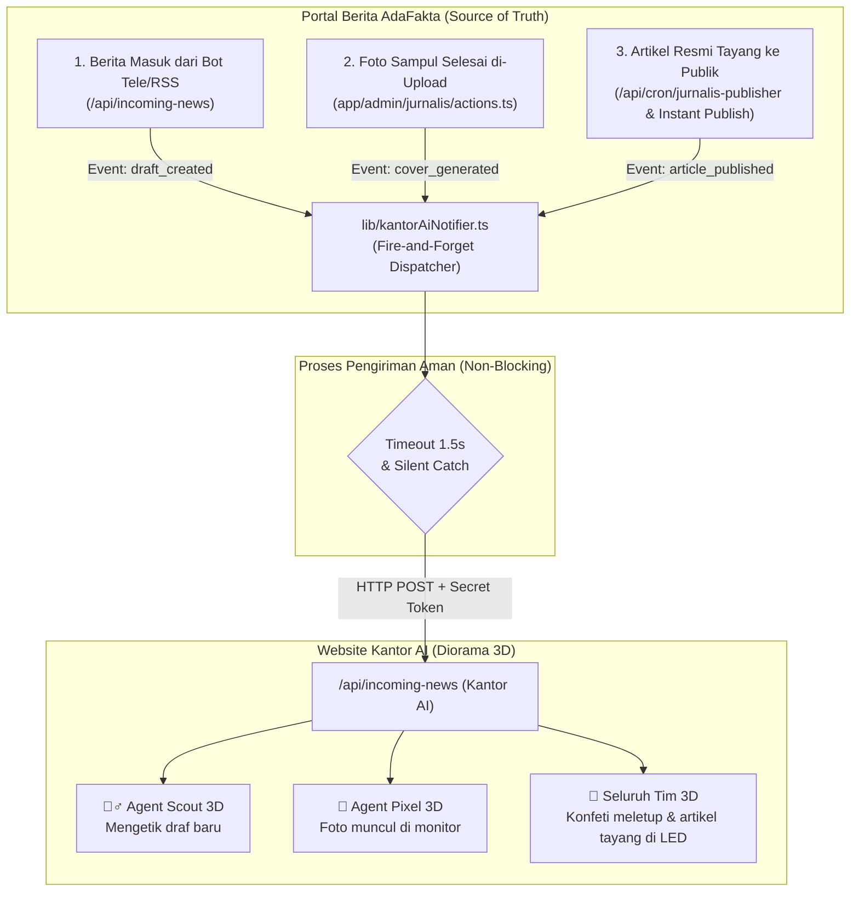

# 📋 Rencana Implementasi: Integrasi Webhook Pemancar ke Kantor AI (Diorama 3D)

> **Status Dokumen:** 📝 Draft Perencanaan (Menunggu Persetujuan Pengguna)  
> **Prinsip Utama:** Tidak ada file kode yang diubah/diimplementasikan sebelum rencana ini disetujui.

---

## 1. Latar Belakang & Tujuan

* **Tujuan Utama:** Menghubungkan portal berita AdaFakta dengan website/dashboard visual 3D **Kantor AI**.
* **Cara Kerja:** Setiap kali terjadi aktivitas di AdaFakta, sistem akan memancarkan sinyal ringan (*webhook non-blocking*) ke web Kantor AI.
* **Hasil Visual:** Karakter 3D di meja kerja Kantor AI langsung bereaksi seketika (Agent Scout mencatat berita baru, Agent Pixel memegang kamera dan memajang foto, seluruh tim merayakan konfeti saat berita terbit).

---

## 2. Diagram Alur Sinyal Webhook (Architecture Workflow)



---

## 3. Rincian Berkas yang Dibuat dan Diubah

### A. Berkas Baru: [`lib/kantorAiNotifier.ts`](file:///e:/porto/naratif/lib/kantorAiNotifier.ts)
Modul utilitas mandiri untuk memancarkan sinyal ke Kantor AI:
* **Prinsip *Fire-and-Forget*:** Tidak memblokir alur utama eksekusi di AdaFakta.
* **Strict AbortController Timeout (1.5 Detik):** Jika web Kantor AI sedang lambat, koneksi langsung diputus otomatis tanpa memperlambat AdaFakta.
* **Silent Catch (`.catch(() => {})`):** Jika web Kantor AI sedang mati/offline, AdaFakta tetap berjalan 100% normal tanpa menampilkan error apapun.

```typescript
export interface KantorAIPayload {
  action: 'draft_created' | 'article_published' | 'cover_generated';
  title: string;
  category?: string;
  coverUrl?: string;
  source?: string;
}

export async function notifyKantorAI(payload: KantorAIPayload): Promise<void> {
  const endpoint = process.env.KANTORAI_URL?.trim();
  const secret = process.env.KANTORAI_WEBHOOK_SECRET?.trim();

  // Jika URL belum disetel, abaikan dengan senyap
  if (!endpoint) return;

  try {
    const controller = new AbortController();
    const timeout = setTimeout(() => controller.abort(), 1500);

    fetch(`${endpoint}/api/incoming-news`, {
      method: 'POST',
      headers: {
        'Content-Type': 'application/json',
        'x-webhook-token': secret || '',
      },
      body: JSON.stringify(payload),
      signal: controller.signal,
    })
      .catch(() => {
        // Abaikan kesalahan koneksi agar tidak pernah mengganggu AdaFakta
      })
      .finally(() => clearTimeout(timeout));
  } catch {
    // Zero-crash guarantee
  }
}
```

---

### B. Konfigurasi Environment: [`.env.local`](file:///e:/porto/naratif/.env.local)
Menambahkan 2 baris variabel konfigurasi:

```env
# ========================================================
# KANTOR AI WEBHOOK NOTIFIER
# ========================================================
# URL web Kantor AI (gunakan localhost saat dev, ganti URL Vercel saat online)
KANTORAI_URL="http://localhost:3000"

# Token rahasia webhook (harus sama dengan token di Kantor AI)
KANTORAI_WEBHOOK_SECRET="kantorai_secret_super_aman_2026"
```

---

### C. Titik Pemasangan di Kode yang Sudah Ada

#### 1. Titik 1: Saat Draf Baru Masuk ([`app/api/incoming-news/route.ts`](file:///e:/porto/naratif/app/api/incoming-news/route.ts#L31))
* **Kapan Dipanggil:** Tepat setelah query `INSERT INTO jurnalis_drafts` berhasil menyimpan berita baru dari bot/RSS.
* **Payload yang Dikirim:**
  ```typescript
  notifyKantorAI({
    action: 'draft_created',
    title: title,
    category: 'Nasional',
    source: source || 'Bot Berita',
  });
  ```

#### 2. Titik 2: Saat Foto Sampul Selesai Dipasang ([`app/admin/jurnalis/actions.ts`](file:///e:/porto/naratif/app/admin/jurnalis/actions.ts#L886))
* **Kapan Dipanggil:** Di dalam fungsi `attachPhotoUrlToDraftAction`, setelah foto ImgBB sukses dikaitkan ke draf.
* **Payload yang Dikirim:**
  ```typescript
  notifyKantorAI({
    action: 'cover_generated',
    title: draft.generatedTitle || draft.title,
    coverUrl: normalizedCoverUrl,
  });
  ```

#### 3. Titik 3: Saat Artikel Resmi Terbit ke Publik
* **Lokasi A (Waterfall Queue):** [`app/api/cron/jurnalis-publisher/route.ts`](file:///e:/porto/naratif/app/api/cron/jurnalis-publisher/route.ts#L100) (saat cron menerbitkan berita terjadwal).
* **Lokasi B (Bypass Instant Publish):** `instantPublishDraftAction` di [`app/admin/jurnalis/actions.ts`](file:///e:/porto/naratif/app/admin/jurnalis/actions.ts#L535).
* **Payload yang Dikirim:**
  ```typescript
  notifyKantorAI({
    action: 'article_published',
    title: newArticle.title,
    category: newArticle.category,
    coverUrl: newArticle.coverUrl || undefined,
  });
  ```

---

## 4. Jaminan Keamanan Sistem (Zero-Impact Guarantee)

| Skenario | Dampak ke Web AdaFakta | Keterangan |
|---|---|---|
| **Web Kantor AI Online & Aktif** | Normal (0 ms delay) | Sinyal terkirim di latar belakang (*background*), karakter 3D bereaksi. |
| **Web Kantor AI Offline / Mati** | Normal (0 ms delay) | Sinyal gagal secara senyap (*silent catch*), AdaFakta tidak error. |
| **Koneksi Lemot / Timeout** | Normal (0 ms delay) | Dibatasi timeout 1.5s dengan `AbortController`, transaksi database AdaFakta tetap aman. |
| **Salah URL / Secret Token** | Normal (0 ms delay) | Hanya ditolak di sisi Kantor AI, AdaFakta tidak terpengaruh sama sekali. |

---

## 5. Rencana Pengujian & Verifikasi

1. **Uji TypeScript:** Jalankan `npx tsc --noEmit` untuk memastikan tidak ada kesalahan tipe data.
2. **Uji Fallback Offline:** Jalankan aksi di AdaFakta saat URL Kantor AI dimatikan $\rightarrow$ pastikan AdaFakta tetap berjalan normal tanpa warning atau error.
3. **Uji Terhubung:** Nyalakan endpoint Kantor AI $\rightarrow$ buat draf atau terbitkan artikel $\rightarrow$ pastikan payload webhook diterima dengan baik di Kantor AI.

---

## 6. Persetujuan Pengguna

Rencana ini telah dirancang secara aman tanpa risiko bagi stabilitas operasional AdaFakta.  
Tidak ada kode yang diubah sebelum ada konfirmasi dari Anda.

Apakah dokumen rencana implementasi di atas sudah sesuai dan siap kita terapkan?

